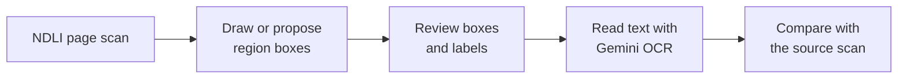
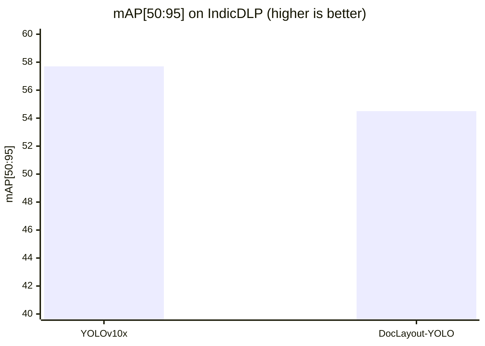

<div align="center">

# &nbsp;

*(Project title intentionally left blank)*

**Name:** Rajdip Dhar  
**Course/Batch:** Computer Science and Engineering  
**Institute:** Heritage Institute of Technology

**Period of Internship:** 21st September 2026 - 30th November 2026

Report submitted to: **IDEAS - Institute of Data Engineering, Analytics and Science Foundation, ISI Kolkata**

**Project Mentor:** Dr. Sujoy Kumar Biswas

</div>

---

## Contents

1. [Abstract](#1-abstract)
2. [Introduction](#2-introduction)
3. [Project Objective](#3-project-objective)
4. [Methodology](#4-methodology)
5. [Data Analysis and Results](#5-data-analysis-and-results)
6. [Conclusion](#6-conclusion)
7. [Appendices](#7-appendices)

---

## 1. Abstract

Document layout analysis locates and labels the regions of a page (headlines, paragraphs, figures, tables, page furniture), and it is the first step of almost every document-digitisation pipeline.
For Bengali and English pages it is hard, because the Bengali script is complex, pages are multi-column and mixed-script, and archival scans are degraded.
The public IndicDLP dataset (119,806 pages, 42 region classes) and its fine-tuned detectors solve the modelling part, but they are released only as research checkpoints with no user interface.
This project builds a web application, the Live Layout Studio, that puts two of these detectors (YOLOv10x and DocLayout-YOLO) behind one interface.
It adds multi-scale inference and Weighted Boxes Fusion to merge several passes or models into one prediction.
It animates detection region by region, is available in English and Bengali (interface and 42 class names), reads the text of each region with Gemini OCR, and writes an English translation of it below the text.
Multi-page PDFs can be processed as a batch, and results export as PNG, JSON, COCO JSON, PAGE-XML, HTML and text in reading order.
The published checkpoints (57.7 and 54.5 mAP[50:95]) are used as released, and one of them is also fine-tuned on annotated Bengali newspaper pages.
On 50 held-out, human-corrected Bengali newspaper pages the ensemble reached 97.9 mAP[50:95] against 89.8 and 90.3 for the two boosted single models, at about 0.37 s per page on a GPU. These figures are circular (the annotators corrected the ensemble's own output, Section 5.4), so they show agreement with that output rather than independent accuracy.
The system makes layout detectors usable and inspectable, and its limits are listed for future work.
The work is the author's part of an eight-intern group project on 800 pages of the Bengali newspaper *Jugantar* (1946, National Digital Library of India): the author annotated Batch 06 of that collection and built the Live Layout Studio (Section 2.7).

---

## 2. Introduction

### 2.1 Relevance

To a computer, a scanned newspaper or textbook page is only a picture.
Layout analysis turns it into a list of **boxes**, each a rectangle `(x1, y1, x2, y2)` with a label such as `headline`, `paragraph`, `figure` or `table` and a confidence score.
This list is needed before text can be read, searched, indexed or made accessible.
India has a very large body of Bengali and other Indic print, much of it archival, and layout models trained mostly on English scientific papers transfer poorly to it.

### 2.2 Technology involved

| Area | Technology |
|---|---|
| Detectors | YOLOv10x (Ultralytics) and DocLayout-YOLO, single-stage object detectors, using the IndicDLP-fine-tuned checkpoints |
| Fusion | Weighted Boxes Fusion (`ensemble-boxes`) |
| Text reading (OCR) | Google Gemini (cloud), one request per region |
| Bengali to English translation | Google Gemini (cloud), a second API key and model setting, one request per region |
| Super-resolution | ESPCN x2 (OpenCV) to sharpen small cutouts |
| PDF input | PyMuPDF renders each PDF page to an image |
| Reading order and exports | Recursive XY-cut; COCO JSON, PAGE-XML and HTML writers (text and English translation); per-class AP (`detmetrics.py`) |
| Interface | Streamlit with a custom JavaScript component for clickable boxes |
| Runtime | Python, PyTorch (CUDA or CPU), Pillow, NumPy, OpenCV |

### 2.3 Background material survey

- **IndicDLP** (Nath et al., 2025): 119,806 pages from 12 document types, 1,856,241 human-drawn boxes, 42 classes, built with the Shoonya annotation tool. It is the dataset the checkpoints were trained on.
- **YOLOv10** (Wang et al., NeurIPS 2024): a real-time detector trained to give one prediction per object, so it needs no non-maximum suppression (NMS). The YOLOv10x checkpoint was pretrained on UED-mini (about 75,000 pages from DocLayNet and M6Doc) and then fine-tuned on IndicDLP.
- **DocLayout-YOLO** (Zhao et al., 2024): a YOLOv10-derived detector for documents, pretrained on synthetic layout pages and adding a Global-to-Local Controllable Receptive Module for page-level structure and small regions.
- **Weighted Boxes Fusion** (Solovyev et al., 2021): instead of discarding overlapping boxes as NMS does, it averages the coordinates of overlapping boxes of the same class, weighted by confidence.
- **Sarvam Akshar** (Sarvam AI): an example that links extracted text to labelled blocks on an *Amrita Bazar Patrika* page. It was the reference for an interface where a reader compares a region and its text with the source image.
- **Label Studio** (HumanSignal): the annotation tool in which the group drew and reviewed the region boxes (rectangle labels with an editable transcription per region).
- **Gemini API** (Google): image understanding, used for the region-level Bengali transcription, and text generation, used for the Bengali to English translation of each transcription (two separate API keys).

### 2.4 Procedure used

Two released detectors were wrapped so that both return the same record per region. Their outputs were combined by multi-scale inference and WBF. The results were put behind an interactive Streamlit interface with language switching, OCR and export. The pipeline was then benchmarked on 100 newspaper pages, evaluated against the human annotation of those same pages, and one detector was fine-tuned on part of them. Section 4 gives the details.

### 2.5 Purpose

To make state-of-the-art Indic layout detectors easy to run, compare and inspect, so that a researcher or archivist can drop in a page, see what each model finds, and judge where a prediction may be wrong.

### 2.6 Topics covered in the first two weeks of training

As listed in the group report for the IDEAS-TIH Section 2 schedule [reference 17]:

- **21-25 September:** internship orientation; GitHub and AWS basics; building data science applications using Streamlit; basic statistics for data science; exploratory data analysis using XInsight.
- **28 September - 2 October:** three machine learning sessions; how large language models work and are trained; an introduction to AI agents and agentic AI.

### 2.7 The group project this work belongs to

This report is the author's individual part of the group project *Understanding Historical Newspaper Images* (layout detection, advertisement analysis and Bengali OCR), carried out by eight interns [reference 10]. The group report asks how to understand historical newspaper images by finding the regions of a page, deciding their roles and reading the text they contain.

**Corpus.** The group downloaded 800 pages of the Bengali newspaper *Jugantar* from the National Digital Library of India (NDLI) [reference 15], covering 1 January to 25 April 1946, and split them into eight batches of 100 pages, one per intern. The corpus is bounded by newspaper and date and was not sampled at random from the wider archive.

| Batch | Intern | Issue dates (1946) |
|---|---|---|
| 01 | Abhinav Dey | 1-14 January |
| 02 | Advay Mishra | 14-27 January |
| 03 | Agniva Roy | 28 January - 11 February |
| 04 | Anish Goswami | 11-25 February |
| 05 | Gaurav Vyas | 26 February - 11 March |
| **06** | **Rajdip Dhar (the author of this report)** | **11-26 March** |
| 07 | Shreyosee Sen | 27 March - 10 April |
| 08 | Sritama Kolay | 10-25 April |

**Annotation workflow.** Members drew rectangular boxes directly in Label Studio, or started from detector or AI-tool proposals and reviewed them in the same interface. Each box records a region's position and role, and a text-bearing region carries an editable transcription. Gemini produced a first-pass Bengali transcription of each text region, and members who read Bengali compared it with the source crop and corrected it.



**Label scheme.** An early scheme had six labels. The final scheme has five, and the advertisement boxes were removed during editorial cleanup. Advertisements were studied separately as a binary classification problem (Section 5.8).

| Stage | Labels | Treatment of advertising |
|---|---|---|
| Early annotation | Heading, subheading, body text, image, caption, advertisement | Advertisement was a sixth label |
| Final annotation | Heading, subheading, body text, image, caption | Commercial boxes were removed during editorial cleanup |
| Separate classifier | Advertisement / non-advertisement | A binary model treats ads as their own recognition problem |

**What is in this repository.** The Live Layout Studio (layout detection, fusion, inspection, export), the layout evaluation and the Batch 06 annotation and transcription belong to this author. The group's other components, the Batch 01 annotation and OCR pipeline and the advertisement classifier (Abhinav Dey), and the *Amrita Bazar Patrika* pilot (Advay Mishra), are separate repositories; their reported results are summarised in Section 5.8 and were not re-run here.

---

## 3. Project Objective

1. To build a single web interface over two IndicDLP layout detectors (YOLOv10x and DocLayout-YOLO) for English and Bengali document pages.
2. To improve recall on small and faint regions by multi-scale inference and ensemble fusion (Weighted Boxes Fusion), and to measure its effect against the single models.
3. To make detection observable: a live region-by-region reveal, clickable boxes with coordinates and cutouts, and an interface and class names in English and Bengali that can be switched without re-running the models.
4. To extract the text of each region with Gemini OCR, translate it into English, and support multi-page PDF input, batch processing and export as PNG, JSON, COCO JSON, PAGE-XML, HTML and reading-order text (with the English translation under each text).
5. To benchmark the models and measure per-class AP of the single models, the multi-scale boost and ensemble fusion (with tuned fusion weights) on human-annotated pages, and to report the limitations honestly.

*Hypothesis testing: none was carried out. Sample survey: none was conducted, so there is no target population.*

---

## 4. Methodology

### 4.1 Overall workflow

```mermaid
flowchart LR
    A["Study IndicDLP, YOLOv10,<br/>DocLayout-YOLO, WBF"] --> B["Obtain released checkpoints<br/>(Zenodo)"]
    B --> C["Unified wrapper:<br/>box, conf, class, label"]
    C --> D["Multi-scale boost<br/>1024 px + 1280 px"]
    D --> E["WBF per model<br/>IoU 0.60"]
    E --> F["Ensemble WBF<br/>across models, IoU 0.55"]
    F --> G["Reading order<br/>(XY-cut)"]
    G --> H["Streamlit UI:<br/>PDF, batch, reveal, click"]
    H --> I["OCR + English translation, ESPCN upscale,<br/>PNG / JSON / COCO / PAGE-XML / HTML / TXT"]
    I --> J["benchmark.py and<br/>evaluate_fusion.py"]
```



### 4.2 Steps carried out

1. **Literature and dataset study.** Read the IndicDLP, YOLOv10, DocLayout-YOLO and WBF papers; studied the 42-class schema and the annotation guideline (`guidelines/`).
2. **Model acquisition.** Downloaded the two released checkpoints (`md2_PT_indicdlp_FT.pt`, 64 MB; `doclayout_yolo_indicdlp.pt`, 161 MB) with a size check, so a partial download is reported instead of crashing the app.
3. **Unified detection layer.** Each model is wrapped so it returns `{box (x1,y1,x2,y2), conf, cls, label}`. Fusion, rendering and export are therefore written once.
4. **Multi-scale boost.** Each YOLO-type model runs at size S (1024 px, the training size) and at S2 (1280 px). The two prediction sets are fused.
5. **Weighted Boxes Fusion.** Boxes are normalised to [0,1]. Same-class boxes are clustered when IoU exceeds 0.60 (scales) or 0.55 (models). A fused box is the confidence-weighted average of its cluster, and its score is the cluster maximum.
6. **Reading order.** A recursive XY-cut (`layout_order.py`) splits the page at the widest empty band, relative to the page size: stacked sections are read top to bottom and columns left to right, so a full-width headline precedes the columns beneath it. It replaces the earlier 40 px band sort. It is a geometric rule, **not** a learned model.
7. **Localisation.** Class names and all interface text are stored once in English and translated at display time by `i18n.py` (English or Bengali, chosen with the Language selector at the top of the sidebar), so changing language never triggers inference. Exported files, the annotated PNG and the OCR prompts stay in English.
8. **Interface.** Streamlit app with a file manager, a sample gallery (the 100 Batch 06 newspaper pages from `batch_06/`), a language selector (English / Bengali), model toggles, confidence / NMS-IoU / inference-size controls, a simplified six-family class view, and a custom component for clickable boxes.
9. **OCR and enhancement.** Gemini reads the text-bearing regions, one request per region; figures, tables, formulas, advertisements and placeholder text are skipped. In the **Ensemble Fusion** tab (which opens first) the text is read live in the background, four requests in parallel: a progress bar fills up and the annotated page stays on screen, where a green ✅ appears over each box as soon as its text is back (a red ❌ marks a region that could not be read). Every box is clickable the moment its ✅ appears, even while the others are still being read; clicking opens a dialog where its text can be **edited by hand** or the region can be read again with **Redo OCR**; edits are kept and are used in every export. Each text is then **translated into English** by a second Gemini key (`GEMINI_TRANSLATE_API_KEY`): proper English sentences that keep the meaning, written below the OCR text of the region, editable in the same dialog and re-created with **Translate to English**. The Results section has a live **Translation benchmark** table next to the OCR one (regions translated, average and median time per region, average characters in and words out, errors, per model). It is measured in the session; the English is not scored for quality because the pages have no human reference translations. ESPCN x2 can upscale a small crop first.
10. **Export.** Annotated PNG, detections JSON, a full cutout JSON with cropped images, and, new, COCO JSON (`bbox` in pixels, 42 categories, reading order and OCR text), PAGE-XML (2019 schema: regions, reading order, text) and a self-contained HTML page in reading order. The TXT now assembles the OCR text in reading order (`assemble_text`). Wherever a region has an English translation it is exported with the text: on the lines right below it in the TXT and HTML, as `translation_en` in the detections JSON, as `text_en` in COCO JSON, as a second `TextEquiv` (index 1, comment "English translation") in PAGE-XML, and as `translation` in the cutouts JSON and the coordinates table. A sidebar toggle, **Leave out images and ads in exports** (on by default), removes figure and advertisement regions from every export file (JSON, COCO, PAGE-XML, HTML, TXT, cutouts JSON, batch ZIP); the annotated PNG and the on-screen boxes still show them.
11. **PDF input and batch processing.** Uploaded PDFs are rendered page by page (PyMuPDF, 150 dpi, at most 200 pages) into the file manager. **Batch** runs detection (and optionally OCR) on every page without the animation and returns one ZIP: per-page JSON, PAGE-XML and text, plus one COCO file and one HTML file for the whole batch.
12. **Benchmarking.** `benchmark.py` measures size, parameters, latency, detections, confidence, and inter-model agreement on the 100 Batch 06 pages.
13. **Evaluation against human annotation.** `evaluate_fusion.py` computes per-class COCO-style AP (`detmetrics.py`) for each single model, the multi-scale boost and ensemble fusion on the 100 annotated pages (Section 5.4). Even-numbered pages tune the per-model fusion weights (grid 0.5-2.0); odd-numbered pages are held out for scoring. The same script runs on the IndicDLP test split when that dataset is downloaded.

### 4.3 Data

| Item | Details |
|---|---|
| Training dataset | **IndicDLP** (public, released by [AI4Bharat](https://github.com/AI4Bharat/IndicDLP), on Hugging Face): 119,806 pages, 12 document domains, 1,856,241 regions, 42 classes |
| Collection / cleaning / preprocessing | Done by the dataset authors (human annotation, YOLO-format conversion). Not repeated here. |
| Data used in this project | **Batch 06**: 100 scanned pages of the Bengali newspaper *Jugantar* (11-26 March 1946, from NDLI) annotated in Label Studio with 10 classes (Headline, Subtitle, BodyText, Caption, Image, Header, Footer, Folio, PageNumber, Flag), 10,192 regions in total, each with OCR text. Used for the speed and agreement benchmark (Section 5.2, which needs no ground truth), as ground truth for the boxes in Section 5.4, and as the OCR reference in Section 5.6. |
| Inference preprocessing | Convert to RGB, resize to the inference size (default 1024 px on the long side), run the detector, drop boxes below the confidence threshold (default 0.25) |

### 4.4 Model selection, training and validation

- **Model selection.** YOLOv10x and DocLayout-YOLO were chosen because the IndicDLP authors released checkpoints for them, and they are the two best-performing single-stage detectors in the paper's tables (57.7 and 54.5 mAP[50:95]).
- **Training.** **The released checkpoints were not re-trained from scratch; the only training done here is the Batch 06 fine-tune below.** The authors fine-tuned both from pretrained weights (YOLOv10x: UED-mini; DocLayout-YOLO: DocSynth-300K) with mosaic, scale and colour augmentation, and with flips and rotation switched off so text is never mirrored. Training and evaluation scripts for DocLayout-YOLO are included in `doclayout-yolo/`.
- **Train / validation / test split.** The split is the dataset's own, taken from the region counts published with it: 1,465,652 training, 186,284 validation and 184,392 test regions (about 80 / 10 / 10 %). It was not changed here.
- **Validation of this project's pipeline.** Speed, number and confidence of detections and agreement between models were measured on the 100 Batch 06 pages (Section 5.2); those measures need no ground truth. Accuracy is measured against human annotation (Section 5.4). Split: 50 even-numbered pages tune the fusion weights, the other 50 are held out; the detectors themselves are not trained on either.
- **Fine-tuning (done, one experiment).** `finetune_batch06.py` fine-tunes YOLOv10x from the IndicDLP checkpoint on 40 of the 50 even-numbered Batch 06 pages (10 more select the best checkpoint; 40 epochs, 1024 px, batch 2, no flips) with a new 10-class head, and scores it on the same 50 held-out pages as Section 5.4.
- **Not done.** No learned reading-order model was built (the export has no human reading-order labels) and no OCR engine was scored. The text side of Batch 06 is the human-checked transcription in `Rajdip_Dhar/` (Section 5.6), which is the reference an OCR engine would be scored against.

### 4.5 Tools and code

- Python 3.10+ (tested on 3.14), PyTorch, Ultralytics, DocLayout-YOLO, `ensemble-boxes`, Streamlit, Google GenAI (Gemini), OpenCV, Pillow, PyMuPDF.
- Source code: **https://github.com/RajdipDhar2007/IndicDLP-Live-Layout-Studio**

| File | Purpose |
|---|---|
| `app.py` | Streamlit app: inference, fusion, reveal animation, results, exports |
| `i18n.py` | Names of the 42 classes and all interface text in English and Bengali |
| `annotation_view/` | Custom component for clickable boxes and in-browser cutouts |
| `batch_06/` | The 100 Batch 06 page images that the Sample gallery lists (not in git; add the folder locally) |
| `benchmark.py` / `benchmark_results.json` | Speed and agreement benchmark on the 100 pages of `batch_06/`, and its output |
| `evaluate_fusion.py`, `detmetrics.py` | Per-class AP evaluation and fusion-weight tuning (IndicDLP YOLO format or a Label Studio export) |
| `batch06_evaluation_*.json/.md`, `batch06_fusion_weights.json` | Results of that evaluation on Batch 06 |
| `finetune_batch06.py`, `batch06_finetune_results.json` | Fine-tuning of YOLOv10x on the annotated pages and its held-out scores |
| `ocr_reference_stats.py`, `batch06_ocr_reference.json` | Statistics of the human-checked OCR text of the 100 Batch 06 pages, read from `Rajdip_Dhar/2_readable_export/json` |
| `layout_order.py` | XY-cut reading order and reading-order text assembly |
| `exports.py` | COCO JSON, PAGE-XML and HTML writers (OCR text and its English translation) |
| `pdfio.py` | PDF page rendering |
| `tests/` | Unit tests (`python -m pytest tests -q`) |
| `doclayout-yolo/` | Train / evaluate / predict scripts for DocLayout-YOLO |
| `ESPCN_x2.pb` | Super-resolution weights |
| `dataset_builder.py`, `ad_dataset.py`, `models_benchmark.py`, `train_benchmark.py` | Ad vs Non-Ad classifier benchmark (LeNet-5 and ResNet-18, aspect-ratio letterboxing to 224x224, class-weighted loss); notebook `ad_classifier_benchmark.ipynb` |
| `annotator_standalone.py`, `run_hybrid_gpu_gemini_annotator.py` | Auto-annotators: YOLO layout detection plus Gemini text, written as a Label Studio pre-annotation JSON (set `INPUT_SCANS_DIR`, `OUTPUT_JSON_PATH`, `GEMINI_API_KEYS`) |
| `model_inference.py` | Headless model loading and inference without Streamlit |
| `docs/benchmark/` | Benchmark plan, evaluation report and annotator setup guide from the upstream branch |
| `requirements.txt`, `run_app.bat` | Dependencies and Windows launcher |

### 4.6 How to run

```powershell
git clone https://github.com/RajdipDhar2007/IndicDLP-Live-Layout-Studio.git
cd IndicDLP-Live-Layout-Studio
python -m venv .venv
.\.venv\Scripts\Activate.ps1                                   # Linux/macOS: source .venv/bin/activate
pip install torch torchvision --index-url https://download.pytorch.org/whl/cu128   # CPU only: pip install torch torchvision
pip install -r requirements.txt
python -m streamlit run app.py                                  # open http://localhost:8501
```

On first launch the sidebar offers a **Download weights** button for each missing checkpoint (about 225 MB in total; Zenodo record 15881917). Gemini OCR needs an API key in the sidebar or in `GEMINI_API_KEY`, and the Bengali to English translation needs a second, separate key in the sidebar or in `GEMINI_TRANSLATE_API_KEY`. Put them in `.streamlit/secrets.toml` (git-ignored, never commit keys) as `GEMINI_API_KEY = "..."` and `GEMINI_TRANSLATE_API_KEY = "..."`. Without the OCR key, detection and every export still work and only the text is left out; without the translation key the text is read but not translated. On the Gemini free tier a model allows about 15 requests a minute, so a page of about 120 regions takes several minutes: the app spaces its requests accordingly and waits when Gemini answers that the limit is reached. An NVIDIA GPU is recommended but not required.

**Using the app:** add pages in the File manager (or choose the Sample gallery, which lists the Batch 06 pages and needs the local `batch_06/` folder), press **Scan & detect**, watch the reveal, then use the result tabs. Click a box for its coordinates, cutout, ESPCN upscale, its text and the English translation below it (edit either, press Redo OCR to read the region again, or Translate to English to translate it again). Change **Language / ভাষা** at the top of the sidebar to switch the whole interface (English or Bengali) without re-running the models.

| Setting | Default | Range |
|---|---|---|
| Multi-scale boost | On | On / Off |
| Ensemble fusion | On | On / Off |
| Confidence threshold | 0.25 | 0.05 - 0.95 |
| NMS IoU | 0.70 | 0.10 - 0.95 |
| Inference size | 1024 | 640, 800, 1024, 1280 |

---

## 5. Data Analysis and Results

All numbers below come from `benchmark_results.json` (GPU run: confidence 0.25, NMS IoU 0.70, 1024 px, 3 timed repetitions after a warm-up, the 100 Batch 06 pages).

> **Caveat for 5.2.** The 100 images are the Batch 06 newspaper pages in `batch_06/`: one Bengali newspaper over about two weeks of March 1946, so the pages are all of one kind. These figures describe behaviour and cost, **not accuracy**; accuracy against human annotation is in Section 5.4.

### 5.1 Comparative analysis of the models (prediction accuracy)

Accuracy is COCO-style mAP averaged over IoU 0.50-0.95, as **published** in the IndicDLP paper. It was not re-measured here, and the paper does not say whether it is on the validation or test split.

| Model | mAP[50:95] | Source | Parameters | File size |
|---|---|---|---|---|
| YOLOv10x (UED-mini pretrained, fine-tuned) | **57.7** | IndicDLP paper, Table 6 | 31.7 M | 64.3 MB |
| DocLayout-YOLO (fine-tuned) | 54.5 | IndicDLP paper, Table 4 | 20.0 M | 161.5 MB |
| YOLOv10x without UED-mini pretraining | 55.0 | IndicDLP paper, Table 4 | - | - |
| Ensemble Fusion (this project) | not published | - | - | - |



YOLOv10x leads by 3.2 points, and its UED-mini pretraining adds about 2.7 points (57.7 vs 55.0).

### 5.2 Descriptive analysis

**Mean over the 100 Batch 06 pages**

| Pipeline | Regions / page | Classes / page | Mean confidence | Time / page (single pass, 1024 px) | Time / page (multi-scale) |
|---|---|---|---|---|---|
| YOLOv10x | 79.7 | 10.4 | 0.680 | 79 ms | 195 ms |
| DocLayout-YOLO | 82.2 | 10.0 | 0.679 | 70 ms | 169 ms |
| **Ensemble Fusion** | **101.9** | **12.1** | 0.670 | - | 369 ms (both models, boosted, fused) |

Total regions over the 100 pages: YOLOv10x 7,966, DocLayout-YOLO 8,222, Ensemble 10,193.

**Spread over the pages (minimum / median / maximum)**

| Pipeline | Regions per page | Time per page, multi-scale (ms) |
|---|---|---|
| YOLOv10x | 43 / 81 / 123 | 178 / 192 / 249 |
| DocLayout-YOLO | 46 / 86 / 130 | 159 / 168 / 190 |
| **Ensemble Fusion** | 56 / 103.5 / 157 | 343 / 365 / 419 |

The ensemble returned more regions than both single models on every one of the 100 pages. The densest page is `1946-03-23_page_004.jpg` (157 regions in the ensemble, 355 ms).

**Agreement between models** (fraction of one model's boxes that have a same-class box with IoU >= 0.5 in the other, averaged over the 100 pages)

| Comparison | Agreement |
|---|---|
| YOLOv10x boxes found by DocLayout-YOLO | 86.3 % |
| DocLayout-YOLO boxes found by YOLOv10x | 83.7 % |
| YOLOv10x boxes kept in the Ensemble | 99.2 % |
| DocLayout-YOLO boxes kept in the Ensemble | 99.4 % |

OCR was not timed here: the app reads text with Gemini (cloud) and the text reference for Batch 06 is the human-checked transcription (Section 5.6). Inside the app, the Results section has live OCR and Translation benchmark tables that time the Gemini requests of the current session (they depend on the network and on Gemini's rate limits, so they are not comparable with the detector timings above).

### 5.3 Inferential analysis

No hypothesis test or confidence interval was computed. The speed benchmark (100 pages) is descriptive and has no ground truth, and the 50 held-out pages of Section 5.4 come from one newspaper and period. Differences of about one point in mAP between pipelines are therefore descriptive and should not be read as statistically significant.

### 5.4 Evaluation against human annotation (Batch 06)

**Data.** 100 scanned pages of the Bengali newspaper *Jugantar* (11-26 March 1946, NDLI) from the Label Studio export of 2026-11-21 (kept locally as `export_2026-11-21/`, not in the repository): 9,621 regions in 5 classes (BodyText 5,232, Image 1,547, Subtitle 1,530, Headline 1,251, Caption 61). The other five classes of the earlier export (Header, Footer, Folio, PageNumber, Flag) are no longer annotated, so they have no ground truth and are shown as "-". The 50 even-numbered pages tune the fusion weights; the 50 odd-numbered pages (5,106 regions, counts per class below) are held out and scored. The detectors' 42 classes are folded onto the annotation classes (`LS_CLASS_MAP` in `evaluate_fusion.py`; advertisements are counted as `Image`, all other text classes as `BodyText`, which is an assumption). Metric: COCO-style AP over IoU 0.50-0.95 (101-point), confidence cut-off 0.001, inference size 1024 (second scale 1280). The models are run on the **original** page images (`batch_06/`); the export's own `images/` folder has the boxes drawn on it and must not be used for scoring or training. Reproduce with:

```
python evaluate_fusion.py --ls-images batch_06 --ls-json export_2026-11-21/json --out-prefix batch06
```

**Overall (50 held-out pages)**

| Pipeline | mAP50 | mAP[50:95] |
|---|---|---|
| YOLOv10x, single scale | 88.5 | 84.1 |
| YOLOv10x, multi-scale boost | 93.0 | 89.8 |
| DocLayout-YOLO, single scale | 88.9 | 85.0 |
| DocLayout-YOLO, multi-scale boost | 92.9 | 90.3 |
| **Ensemble fusion, equal weights** | **99.5** | **97.9** |
| Ensemble fusion, tuned weights (equal, 1.0 / 1.0) | 99.5 | 97.9 |

**Read this table with care: it is circular.** The annotators corrected pre-annotations produced by this very ensemble (`run_ensemble.py`, same settings as the app), so the ground-truth boxes are largely the ensemble's own output. The ensemble scoring 99.5 mAP50 is the signature of that. The table therefore measures how closely each pipeline reproduces the corrected ensemble output, not how accurate each is against independent ground truth. The earlier version of this section (an older, less-corrected export, scored on images with the boxes drawn on them) reported 33.7 mAP[50:95] for the ensemble; those figures are superseded and should not be compared with these.

**Per-class AP[50:95] (held-out pages)**

| Class | GT boxes | YOLOv10x | YOLOv10x + boost | DocLayout | DocLayout + boost | Ensemble | Ensemble, tuned |
|---|---|---|---|---|---|---|---|
| Headline | 683 | 82.7 | 89.3 | 87.4 | 92.6 | 96.6 | 96.6 |
| Subtitle | 745 | 71.1 | 76.7 | 87.2 | 94.1 | 97.1 | 97.1 |
| BodyText | 2963 | 92.5 | 95.1 | 92.8 | 95.3 | 97.9 | 97.9 |
| Caption | 22 | 80.1 | 92.4 | 66.4 | 76.2 | 98.8 | 98.8 |
| Image | 693 | 94.3 | 95.8 | 91.3 | 93.5 | 98.9 | 98.9 |
| Header, Footer, Folio, PageNumber, Flag | 0 | - | - | - | - | - | - |

**Fusion-weight tuning** (DocLayout-YOLO weight relative to YOLOv10x = 1.0, scored on the 50 tuning pages, mAP[50:95]):

| DocLayout-YOLO weight | 0.5 | 0.75 | 1.0 | 1.5 | 2.0 |
|---|---|---|---|---|---|
| mAP[50:95] on tuning pages | 96.5 | 97.8 | **98.4** | 97.7 | 97.4 |

Equal weights (1.0) are best, so `batch06_fusion_weights.json` equals the default and no override is needed.

**Caveats.** (1) The circularity above. (2) Caption (22 held-out boxes) is too small for a reliable AP. (3) One newspaper and period only.

### 5.5 Fine-tuning on the annotated pages

YOLOv10x fine-tuned on 40 Batch 06 pages (`weights/yolov10x_batch06_ft.pt`, not committed), trained and scored on the original page images, on the same 50 held-out pages and with the same metric as Section 5.4:

```
python finetune_batch06.py --export export_2026-11-21 --images batch_06
```

| Pipeline (50 held-out pages) | mAP50 | mAP[50:95] |
|---|---|---|
| Ensemble fusion of the two original models (Section 5.4) | 99.5 | 97.9 |
| **Fine-tuned YOLOv10x, single scale** | 72.0 | 65.4 |
| **Fine-tuned YOLOv10x, multi-scale boost** | 73.1 | 67.1 |

| Class | GT boxes | AP[50:95], single | AP[50:95], boost |
|---|---|---|---|
| Headline | 683 | 77.1 | 79.2 |
| Subtitle | 745 | 69.9 | 72.3 |
| BodyText | 2963 | 86.1 | 86.9 |
| Caption | 22 | 14.2 | 16.2 |
| Image | 693 | 79.5 | 80.8 |

(The mAP50 and mAP[50:95] columns average over the 10 classes in the model's head, of which five have no ground truth and are skipped.) The fine-tuned model scores **below** the untouched ensemble here (67.1 vs 97.9), which is the opposite of the earlier result, and the reason is the circularity of Section 5.4: the labels now follow the ensemble's box style, which a model trained on 40 pages cannot match. This comparison therefore cannot show whether fine-tuning helps. It is a one-run result (seed 0, no repeats) on one newspaper; the earlier large gains on Folio and Header cannot be reproduced because those classes are no longer annotated.

### 5.6 OCR text of Batch 06 (human-checked reference)

For the 100 Batch 06 pages the OCR text is taken from the annotator's folder `Rajdip_Dhar/2_readable_export/json` (one file per page, every region with its class, box and transcription). No OCR engine is run to produce it. `ocr_reference_stats.py` summarises it into `batch06_ocr_reference.json`. The transcription was kept while annotating (Gemini helped with it), so it is a very good reference but not independent ground truth.

| Measure | Value |
|---|---|
| Pages | 100 |
| Regions with a transcription | 8,074 of 8,074 |
| Characters (without counting empty regions) | 1,542,581 (mean 191 per region, 15,426 per page) |
| Regions per page | mean 80.7, median 85 |
| Share of letters that are Bengali | 99.7 % (the rest is Latin) |

| Class | Regions | Mean characters per region |
|---|---:|---:|
| BodyText | 5,232 | 278.4 |
| Subtitle | 1,530 | 28.2 |
| Headline | 1,251 | 30.6 |
| Caption | 61 | 73.7 |

Image regions were left out of the transcription on purpose, so they carry no text. Scoring an OCR engine (for example Gemini) against this reference, region by region, has not been done here; it needs an API key and is listed under future work.

### 5.7 Observations

- The ensemble found about 28 % more regions per page than YOLOv10x and 24 % more than DocLayout-YOLO (101.9 vs 79.7 and 82.2), because the two models agree on 84-86 % of their boxes and WBF keeps a region when only one model finds it. This benchmark alone cannot say how many of the extra regions are correct, and some may be false positives or near-duplicates.
- Mean confidence was almost unchanged (0.670 vs 0.679-0.680).
- Multi-scale inference roughly 2.4 to 2.5 times the time (79 to 195 ms and 70 to 169 ms), and the full ensemble costs about 0.37 s per page (343-419 ms), which is acceptable for interactive use on a GPU.
- On the human-corrected pages the multi-scale boost lifted mAP[50:95] by 5.7 points for YOLOv10x (84.1 to 89.8) and 5.3 for DocLayout-YOLO (85.0 to 90.3), and the ensemble added a further 7.6-8.1 points over either boosted model (97.9). The ensemble's lead is inflated by the circularity described in Section 5.4.
- DocLayout-YOLO is clearly better on body text (64.7 vs 48.3) and flags; YOLOv10x is better on subtitles. The ensemble is best or near-best on most classes, and weakest on small page furniture (Folio, PageNumber below 6 AP), exactly the classes the report names as hard.
- Equal fusion weights were best on the tuning pages (Section 5.4), so they remain the default.
- Cost is nearly constant across pages (343-419 ms for the ensemble) because every page is resized to the same inference size: even the densest page (157 regions) took 355 ms.


### 5.8 Related group results (reported by other interns)

The figures in this section come from the group report [reference 10] and the component reports it cites [references 11-13]. They were produced by other interns' code and data, which are not in this repository, and were **not** re-run or checked here. They are included so the layout work above can be read next to the rest of the project.

**Group annotation inventory.** Of the 800 allocated pages, seven checked Label Studio exports (batches 01-03 and 05-08) were available for review; the checked Batch 04 export was not in the supplied folder. They hold 700 page tasks, of which 699 contain labelled rectangles. Counting one active annotation per task gives **41,813 boxes**, **33,279** of them with non-empty text linked to the region ID. When a task had several active annotations, the marked ground truth was used, otherwise the latest saved one.

| Class | Boxes |
|---|---:|
| Body text | 26,330 |
| Subheading | 8,084 |
| Heading | 6,567 |
| Image | 439 |
| Caption | 393 |
| **Total** | **41,813** |

A non-empty transcription field measures coverage only: it does not show that the text is correct. The group report gives an example of a stored output that is clearly wrong, so no corpus-wide Bengali character or word error rate is claimed.

**Batch 01 annotation and OCR release** (Abhinav Dey). Before cleanup the 100 pages had 8,258 automatic boxes (8,206 stored text entries). After manual review the release has 5,750 editorial boxes (5,707 text entries), a reduction of 2,508 boxes (30.4 %) from removing advertisements and stray detections.

**Advertisement classifier** (Abhinav Dey). Early crop classifiers confused framed editorial material with advertisements, so a binary experiment added difficult non-advertisement crops (boxed news, bulletins, tall single-column stories) mined from 700 additional scans. Crops were padded to 224 x 224 pixels while keeping their aspect ratio, and a modified LeNet-5 was compared with ResNet-18 on a stratified split of the crops (68,043 in total: 30,405 advertisements and 37,638 non-advertisements).

| Split | Advertisements | Non-advertisements | Total crops |
|---|---:|---:|---:|
| Training | 24,324 | 30,110 | 54,434 |
| Validation | 3,040 | 3,763 | 6,803 |
| Test | 3,041 | 3,765 | 6,806 |

| Metric (6,806 test crops) | Modified LeNet-5 | ResNet-18 |
|---|---:|---:|
| Accuracy | 82.41 % | **85.01 %** |
| Advertisement precision | 75.47 % | 80.48 % |
| Advertisement recall | 89.84 % | 87.73 % |
| F1 | 0.8203 | 0.8395 |
| ROC-AUC | 0.9130 | 0.9334 |
| Editorial regions flagged as ads (false positives) | 888 | 647 |
| Missed advertisements (false negatives) | 309 | 373 |

ResNet-18 produced 241 fewer false positives and 64 more false negatives than the modified LeNet-5, so its lower advertisement recall matters if the classifier is used to exclude regions from later analysis. On a 30-page full-page inspection that added page context (mastheads, editorial roles, figure-caption proximity), the pipeline reported 367 advertisements and protected 2,247 regions as editorial, at a mean 4.85 s per page. Remaining errors included ad-like editorial columns, advertisements near mastheads and small cinema advertisements.

**Amrita Bazar Patrika pilot** (Advay Mishra). A supporting pilot on 100 NDLI scans of *Amrita Bazar Patrika* from 12 issues dated 1-12 April 1946 tested whether the region-based approach transfers to English OCR and issue metadata. A page-header crop was read with a local Qwen3-VL model; the body text used fused IndicDLP proposals and PP-OCRv6 models through PaddleOCR.

| Measurement | Reported result |
|---|---|
| Printed-date reading before issue checks | 91.9 % (Qwen3-VL-4B), 98.0 % (8B) on the printed-date subset |
| Metadata after issue checks | For both models: 100/100 page dates, 100/100 page numbers and 12/12 issue numbers agree with the scraper labels |
| English OCR output | 11,506 text records, 2,905,424 characters, from 100 pages |
| English character error rate | 1.9 % in four manually transcribed regions (24 of 1,240 characters) |
| Runtime on the reported M1 laptop | 8.5 s per page for layout; 19.8 h in total for OCR |

**Limits the group report states for these results.** The work is an engineering study on archival pages with no survey or formal hypothesis test. The layout comparison in Section 5.4 uses reference boxes derived from the tested ensemble, so it favours systems that reproduce the ensemble's box conventions. The advertisement benchmark splits crops rather than issues, so independence at the issue level is unverified. The four-region English spot check supports statements about those regions only. These limits prevent extending the scores to the full archive.

---

## 6. Conclusion

- **A usable system was delivered.** Two research checkpoints now run behind one interface that supports live reveal, clickable cutouts, an English/Bengali interface and labels, OCR, multi-page PDF input, batch processing, and export as PNG, JSON, COCO JSON, PAGE-XML, HTML and reading-order text, and that falls back gracefully when a model or weights file is missing.
- **Ensemble fusion increases coverage.** On the 100 Batch 06 pages it returned 10,193 regions against 7,966 and 8,222 for the single models, and kept 99.2 % and 99.4 % of their boxes. The two detectors agree on only about 84-86 % of their boxes, so they are complementary.
- **The cost is acceptable.** About 0.37 s per page for the full boosted ensemble on a GPU, against 0.07-0.08 s for one model at one size.
- **Fusion agrees best with the human-corrected annotations, but that is circular.** On 50 held-out pages, mAP[50:95] was 84.1 / 85.0 (single scale), 89.8 / 90.3 (multi-scale boost) and 97.9 (ensemble). Because the annotations started from this ensemble's output, this is not independent evidence of accuracy. On the IndicDLP test split the published figures are 57.7 (YOLOv10x) and 54.5 (DocLayout-YOLO); `evaluate_fusion.py` can repeat that evaluation, but the dataset was not available here.
- **Fine-tuning could not be shown to help.** Fine-tuned YOLOv10x reached 65.4 mAP[50:95] (67.1 with the boost) on the held-out pages, below the ensemble's 97.9, because the labels follow the ensemble's own box style. One run, one newspaper, five annotated classes.
- **The Batch 06 text is human-checked.** All 8,074 annotated regions of the 100 pages carry a transcription (99.7 % of the letters are Bengali), which can serve as the reference for scoring any OCR engine.
- **Equal fusion weights are kept.** They scored best on the tuning pages (98.4 vs 97.7 for 1.0 / 1.5).
- **Weak spots are consistent.** Small page furniture, hierarchical classes (headline, list and question levels) and rare classes get the lowest confidence.

**Limitations.** Rectangular boxes only; the reading order is a geometric XY-cut, not a learned model (it can fail on interleaved or overlapping boxes), and it has not been scored against human reading-order labels; the OCR text is assembled in that order, but the OCR itself is Gemini (cloud) and was not scored in this project, and the English translation is Gemini's too and was not scored either (there are no human reference translations of these pages; it was only read through on samples); PDFs are rendered at 150 dpi and capped at 200 pages; Bengali and Indic label translations need native-speaker review; the two released detectors were not re-trained on IndicDLP (only one fine-tune on 40 newspaper pages was run); the speed benchmark covers one newspaper from one period; the accuracy evaluation covers one newspaper from one period with 10 coarse classes; Gemini OCR sends region images to Google, and the translation sends the OCR text to Google. On the Gemini free tier a model allows about 15 requests a minute, so reading and translating a page of about 120 regions takes around ten minutes, and a Gemini overload (503/504) can pause it.

**Recommendations for future work**

1. Run `evaluate_fusion.py` on the IndicDLP validation and test splits (per-class AP over all 42 classes) and re-tune the fusion weights there; the weights tuned on newspaper pages are not independent evidence.
2. Obtain independently annotated pages (not started from the ensemble's output) so the fusion gain can be measured without bias, and add a significance test.
3. Collect human reading-order labels, evaluate the XY-cut against them and train a learned reading-order model; score Gemini and any Bengali-specialised OCR against the human-checked transcription of Batch 06 in `Rajdip_Dhar/`, and have a Bengali reader write reference English translations for a sample of regions so the translation can be scored too.
4. Test the fine-tuned detector on other newspapers and on English pages, repeat with several seeds, and merge the 10-class scheme back into the 42-class output (or fine-tune all 42 classes) so the app can offer it next to the original models.
5. Add per-page quality controls to the batch mode (retry, resume, per-page settings) and larger PDF support.
6. For the group work (group report): split the advertisement evaluation by issue rather than by crop, measure Bengali character and word error rates against direct human transcriptions, and add human reading-order and article-grouping annotations to test how regions connect across columns and pages.

---

## 7. Appendices

### Appendix 1: References

1. A. Wang, H. Chen, L. Liu, et al. *YOLOv10: Real-Time End-to-End Object Detection.* NeurIPS 2024.
2. Z. Zhao, H. Kang, B. Wang, C. He. *DocLayout-YOLO: Enhancing Document Layout Analysis through Diverse Synthetic Data and Global-to-Local Adaptive Perception.* arXiv:2410.12628, 2024.
3. R. Solovyev, W. Wang, T. Gabruseva. *Weighted Boxes Fusion: Ensembling boxes from different object detection models.* Image and Vision Computing, 2021.
4. O. Nath, S. Kukkala, M. Khapra, R. K. Sarvadevabhatla. *IndicDLP: A Foundational Dataset for Multi-Lingual and Multi-Domain Document Layout Parsing.* arXiv:2512.20236, 2025. [Paper](https://arxiv.org/abs/2512.20236), [project page](https://indicdlp.github.io/).
5. IndicDLP code repository, AI4Bharat: [github.com/AI4Bharat/IndicDLP](https://github.com/AI4Bharat/IndicDLP) (MIT licence).
6. IndicDLP dataset: [huggingface.co/datasets/ai4bharat/indicdlp](https://huggingface.co/datasets/ai4bharat/indicdlp). IndicDLP models: [huggingface.co/IndicDLP/IndicDLP-model](https://huggingface.co/IndicDLP/IndicDLP-model).
7. AI4Bharat (AI4Bhārat, IIT Madras): [github.com/AI4Bharat](https://github.com/AI4Bharat), [ai4bharat.iitm.ac.in](https://ai4bharat.iitm.ac.in).
8. Libraries: [Ultralytics](https://github.com/ultralytics/ultralytics), [DocLayout-YOLO](https://github.com/opendatalab/DocLayout-YOLO), [ensemble-boxes](https://github.com/ZFTurbo/Weighted-Boxes-Fusion), [Streamlit](https://streamlit.io), [PyTorch](https://pytorch.org).
9. Model weights: Zenodo record 15881917 (`md2_PT_indicdlp_FT.pt`, `doclayout_yolo_indicdlp.pt`).
10. A. Dey, A. Mishra, A. Roy, A. Goswami, G. Vyas, R. Dhar, S. Sen, S. Kolay. *Autumn Internship Group Report: Understanding Historical Newspaper Images.* IDEAS-TIH, Autumn Internship 2026 (group report; the author of this report is one of its eight authors).
11. A. Dey. *100-Page Newspaper Layout Annotation and Bengali OCR Pipeline.* [Report](https://github.com/Editing-Karne-Wala/IndicDLP-100Page-Annotation-OCR/blob/main/REPORT.md), [repository](https://github.com/Editing-Karne-Wala/IndicDLP-100Page-Annotation-OCR).
12. A. Dey. *Detection of Advertisements in Historical Bengali Newspapers.* [Report](https://github.com/Editing-Karne-Wala/IndicDLP-Ad-Classifier/blob/main/REPORT.md), [repository](https://github.com/Editing-Karne-Wala/IndicDLP-Ad-Classifier).
13. A. Mishra. *Agentic Metadata Extraction for Amrita Bazar Patrika (Part 2)* and *Body-Text OCR for Amrita Bazar Patrika (Part 3)*, internship component reports, November 2026.
14. Sarvam AI. [Introducing Sarvam Akshar](https://www.sarvam.ai/blogs/sarvam-akshar).
15. National Digital Library of India, [newspaper archives](https://www.ndl.iitkgp.ac.in/ndl_nw) (source of the *Jugantar* and *Amrita Bazar Patrika* scans).
16. HumanSignal, [Label Studio: rectangle labels](https://labelstud.io/tags/rectanglelabels). Google, [Gemini API: image understanding](https://ai.google.dev/gemini-api/docs/image-understanding).
17. IDEAS-TIH, *Autumn Internship Program on Data Science 2026: Schedule for Section 2* ([document](https://drive.google.com/file/d/1-n9mhXgLrVqq2qEjLM82VajUzHL2kE39/view)).

#### Acknowledgements

This project builds directly on the work of **AI4Bharat** and the **IndicDLP** authors (O. Nath, S. Kukkala, M. Khapra and R. K. Sarvadevabhatla). The IndicDLP dataset (119,806 pages, 12 document domains, 42 region classes), the IndicDLP annotation guideline and the IndicDLP-fine-tuned YOLOv10x and DocLayout-YOLO checkpoints are their work. They are used here as released; this project did not create them. The author thanks AI4Bharat for releasing the dataset, the models and the code openly ([github.com/AI4Bharat/IndicDLP](https://github.com/AI4Bharat/IndicDLP), MIT licence), and thanks the authors of YOLOv10, DocLayout-YOLO and Weighted Boxes Fusion cited above. The author also thanks the other members of the internship group (Abhinav Dey, Advay Mishra, Agniva Roy, Anish Goswami, Gaurav Vyas, Shreyosee Sen and Sritama Kolay), whose annotation, advertisement-classifier and *Amrita Bazar Patrika* work is summarised in Sections 2.7 and 5.8, and the project mentor, Dr. Sujoy Kumar Biswas. Anyone reusing the dataset or the checkpoints should follow their licences and cite the IndicDLP paper (reference 4).

### Appendix 2: Survey Questionnaire

Not applicable. No survey was conducted.

### Appendix 3: GitHub link for the code

https://github.com/RajdipDhar2007/IndicDLP-Live-Layout-Studio

Other repositories of the group (not part of this repository):

- [100-page *Jugantar* annotation and OCR pipeline](https://github.com/Editing-Karne-Wala/IndicDLP-100Page-Annotation-OCR) (Abhinav Dey)
- [Historical newspaper advertisement classifier](https://github.com/Editing-Karne-Wala/IndicDLP-Ad-Classifier) (Abhinav Dey)
- [Layout implementation](https://github.com/Matrix4576/IndicDLP-Live-Layout-Studio) (Agniva Roy) and [pipeline and benchmark branch](https://github.com/Editing-Karne-Wala/IndicDLP-Live-Layout-Studio/tree/release/pipeline-and-benchmark) (Abhinav Dey)

### Appendix 4: Other documents

- Benchmark data: `benchmark_results.json`, produced by `benchmark.py` (both in the repository).
- Evaluation on human-annotated pages: `batch06_evaluation_results.json`, `batch06_evaluation_per_class.md`, `batch06_fusion_weights.json`, produced by `evaluate_fusion.py`. The annotated pages themselves are in the local folder `export_2026-11-21` (100 pages, 9,621 regions, 8,071 with OCR text; not in the repository). A later hand-in copy of the same 100 pages with four classes (Headline, Subtitle, BodyText, Caption; no Image boxes) is in `Rajdip_Dhar/` (also not in the repository).
- IndicDLP annotation guideline: `guidelines/ANNOTATION_GUIDELINE_BY_CATEGORY.pdf`.
- Group report: *Autumn Internship Group Report: Understanding Historical Newspaper Images* (eight authors, IDEAS-TIH, 2026). Sections 2.6, 2.7 and 5.8 of this `README.md` adapt material from it; the PDF is not stored in the repository.
- Copy of this report: this `README.md`. A PDF copy and the presentation can be added to the repository or Google Drive and linked here.

### Appendix 5: The 42 region classes

| Family | Classes |
|---|---|
| Headlines | headline, sub-headline, subsub-headline |
| Titles | chapter-title, section-title, sub-section-title, subsub-section-title |
| Body text | paragraph, quote, sidebar, author, reference, footnote |
| Lists | ordered-list, sub-ordered-list, subsub-ordered-list, unordered-list, sub-unordered-list, subsub-unordered-list |
| Figures and tables | figure, figure-caption, table, table-caption, formula, table-of-contents, index |
| Page furniture | header, footer, page-number, folio, flag, dateline, jumpline |
| Exam parts | first-level-question, second-level-question, third-level-question, options, answer |
| Other | advertisement, contact-info, placeholder-text, website-link |
