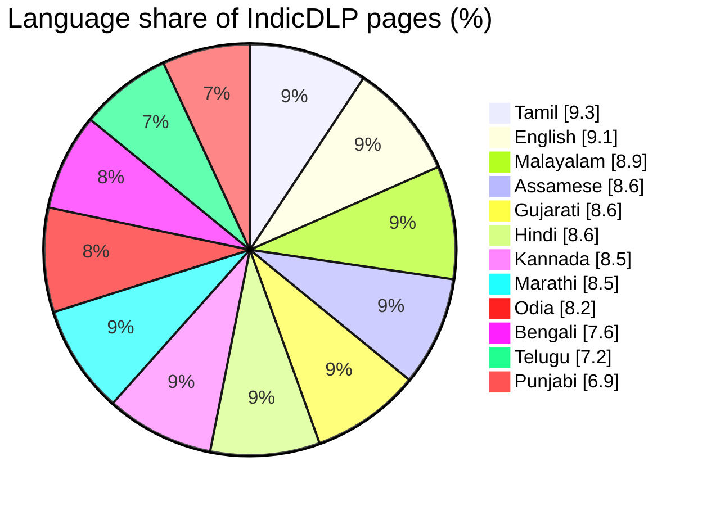
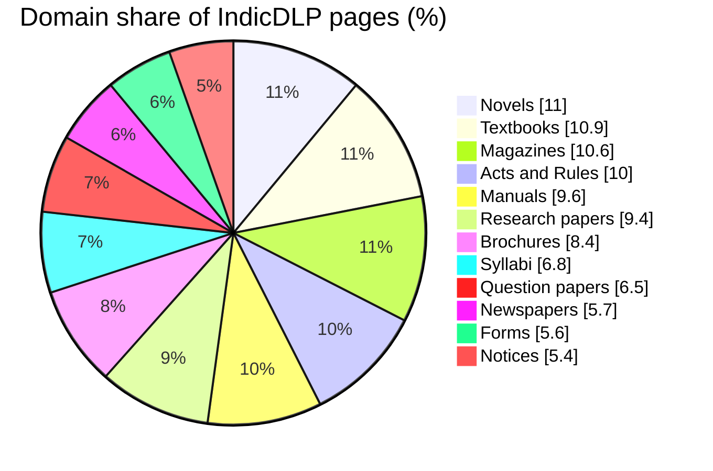
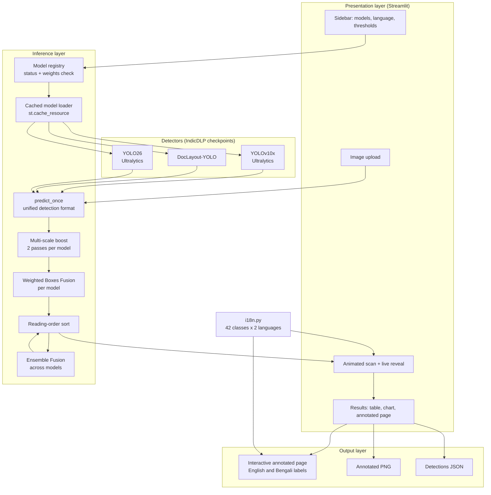
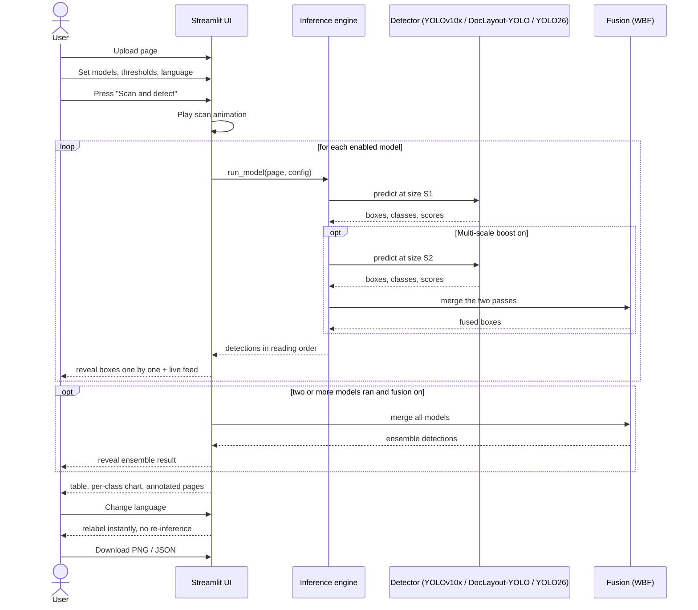
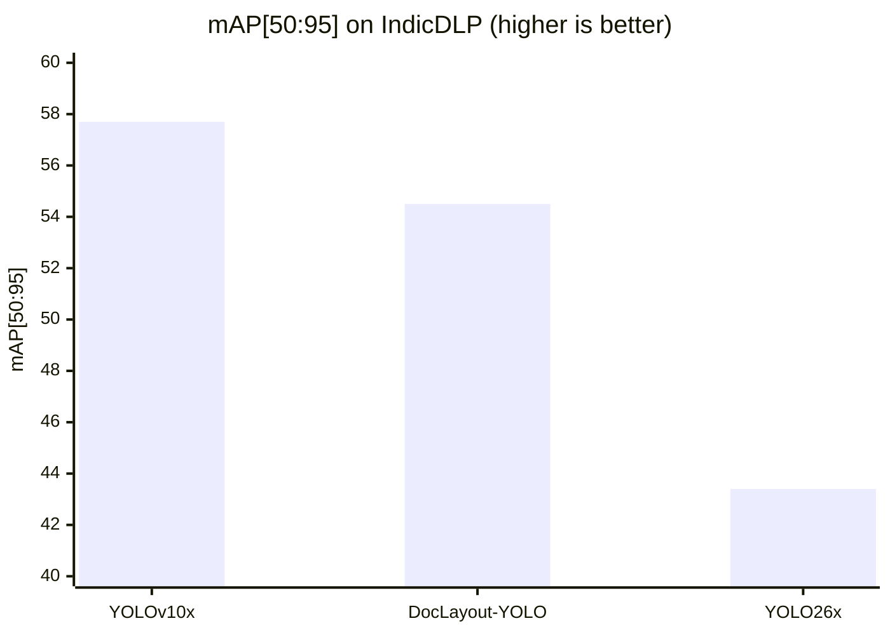

<div align="center">

# IndicDLP Live Layout Studio

### An interactive, multilingual system for document layout parsing of English and Bengali pages, with multi-scale inference and ensemble fusion of deep detectors

</div>

---

## Abstract

Document layout parsing, the task of locating and classifying the structural regions of a page (headlines,
paragraphs, figures, tables, page furniture and so on), is the first step of almost every document digitisation
pipeline. For Indian-language documents, here English and Bengali, the task is difficult: scripts are visually complex, pages are often
multi-column and mixed-script, and a large share of archival material is degraded. The recent **IndicDLP** dataset
and its fine-tuned detectors address this with 119,806 annotated pages in 11 Indic languages and English and a
42-class label schema, but the models are released as research checkpoints with no end-user interface.

This work presents **IndicDLP Live Layout Studio**, a web application that makes those detectors usable and
inspectable. It (i) runs three state-of-the-art detectors (YOLOv10x, DocLayout-YOLO and YOLO26) behind one unified
interface; (ii) adds a **multi-scale inference** stage and an **ensemble fusion** stage based on Weighted Boxes
Fusion, which combine the outputs of several passes or several models into a single, more complete prediction;
(iii) animates the detection process in real time so that the behaviour of each model can be observed region by
region; and (iv) renders the 42 region classes in **English and Bengali**, with colour-coded, exportable results (annotated
PNG and structured JSON).

**Keywords:** document layout analysis, Indic scripts, object detection, YOLOv10, DocLayout-YOLO, YOLO26,
weighted boxes fusion, English and Bengali user interface, Streamlit.

---

## Contents

1. [Introduction](#1-introduction)
2. [Background and related work](#2-background-and-related-work)
3. [Dataset and label schema](#3-dataset-and-label-schema)
4. [System design](#4-system-design)
5. [Methodology](#5-methodology)
6. [Input and output specification](#6-input-and-output-specification)
7. [Experiments and results](#7-experiments-and-results)
8. [Installation and usage](#8-installation-and-usage)
9. [Limitations and future work](#9-limitations-and-future-work)
10. [Project structure](#10-project-structure)
11. [References](#11-references)

---

## 1. Introduction

### 1.1 Problem statement

Given a page image *I*, **layout parsing** produces a set of regions *R = {(bᵢ, cᵢ, sᵢ)}*, where *bᵢ = (x₁, y₁, x₂, y₂)* is
an axis-aligned bounding box, *cᵢ* is a class from a fixed label set (here 42 classes) and *sᵢ ∈ [0, 1]* is a
confidence score. The output is the structural skeleton on which later stages (OCR, reading-order recovery, table
and figure extraction, accessibility tagging, search indexing) depend.

### 1.2 Motivation

- **Script and language diversity.** India has many scripts and languages. Models trained mostly on English
  scientific papers transfer poorly to them.
- **Domain diversity.** Newspapers, textbooks, exam papers, forms, notices and magazines have very different layouts.
- **Degradation.** Archival scans show ink bleed, stains, skew and low contrast.
- **Usability gap.** Research checkpoints are hard to run, compare and inspect. A researcher or archivist should be
  able to drop in a page and see what each model finds, and why a prediction might be wrong.

### 1.3 Contributions

1. A **single web interface** over three detectors (YOLOv10x, DocLayout-YOLO and YOLO26) with automatic
   detection of which models are installed and available.
2. A **multi-scale inference** stage that fuses predictions from two input resolutions per model to recover small
   and faint regions.
3. An **ensemble fusion** stage that merges the predictions of all models with Weighted Boxes Fusion.
4. A **live, animated reveal** of detections with a feed, counters and timing, intended for demonstration and for
   building intuition about model behaviour.
5. **Localised region names** for all 42 classes in English and Bengali, switchable without re-running
   inference.
6. **Export** of results as full-resolution annotated images and structured JSON, plus a per-model comparison table
   and per-class statistics.

---

## 2. Background and related work

**IndicDLP.** A foundational dataset for multi-lingual and multi-domain layout parsing, with detectors fine-tuned
on it. This project uses the released YOLOv10x and DocLayout-YOLO checkpoints unchanged and adds its own YOLO26x.

**YOLOv10.** A real-time, single-stage object detector that removes the need for non-maximum suppression at
inference by using consistent dual assignments during training (Wang et al., NeurIPS 2024). In this project the
YOLOv10x checkpoint was pretrained on a large synthetic layout corpus and then fine-tuned on IndicDLP.

**DocLayout-YOLO.** A YOLOv10-derived detector specialised for documents, using a Global-to-Local Controllable
Receptive Module to handle both page-level structure and small regions (Zhao et al., 2024).

**Weighted Boxes Fusion (WBF).** An ensembling method for detectors (Solovyev et al., 2021). Unlike NMS, which
discards overlapping boxes, WBF clusters overlapping boxes of the same class and *averages their coordinates
weighted by confidence*, which usually gives better localisation. It is used here both for multi-scale and for
multi-model fusion.

---

## 3. Dataset and label schema

The models were trained on **IndicDLP** (statistics below are as published for the whole dataset). This project is
scoped to **English and Bengali**: the app's interface and region names are provided in those two languages only,
although the detectors themselves were trained on all of the languages listed.

| Property | Value |
|---|---|
| Pages | 119,806 high-resolution images |
| Annotations | 1,856,241 rectangular layout regions |
| Languages | 11 Indic languages + English |
| Domains | 12 (novels, textbooks, magazines, acts and rules, research papers, manuals, brochures, syllabi, question papers, notices, forms, newspapers) |
| Sources | Digitally born and scanned documents |
| Labels | 42 physical and logical region classes |
| Annotation tool | Shoonya (open source, built on Label Studio) |





### 3.1 The 42 region classes

For display, the app groups the classes into eight colour families so that related regions are visually related.

| Family | Classes |
|---|---|
| Headlines | headline, sub-headline, subsub-headline |
| Titles | chapter-title, section-title, sub-section-title, subsub-section-title |
| Body text | paragraph, quote, sidebar, author, reference, footnote |
| Lists | ordered-list, sub-ordered-list, subsub-ordered-list, unordered-list, sub-unordered-list, subsub-unordered-list |
| Figures and tables | figure, figure-caption, table, table-caption, formula, table-of-contents, index |
| Page furniture | header, footer, page-number, folio, flag, dateline, jumpline |
| Exam parts | first-level-question, second-level-question, third-level-question, options, answer |
| Other | advertisement, contact-info, placeholder-text, website-link |

---

## 4. System design

### 4.1 Architecture

The system is a single-process Streamlit application. The user interface, the model registry, the inference
engine, the fusion module, the localisation module and the exporters are separate layers.



### 4.2 Components

| Component | File | Responsibility |
|---|---|---|
| Application and UI | `app.py` | Sidebar controls, animations, orchestration, results view, exports |
| Model registry | `app.py` (`MODELS`) | Names, checkpoint files, expected sizes, availability checks |
| Inference engine | `app.py` (`predict_once`, `run_model`) | Runs a model and converts its output to one common format |
| Fusion | `app.py` (`fuse`) | Weighted Boxes Fusion for scales and for models |
| Localisation | `i18n.py` | Names of all 42 classes in English and Bengali |
| Model code | `ultralytics`, `doclayout-yolo` (pip packages) | Upstream implementations required by those checkpoints |

### 4.3 Interaction sequence



---

## 5. Methodology

### 5.1 End-to-end pipeline


### 5.2 Detection and common format

Every model, whatever its framework, is wrapped so that it returns the same record per region:
`{box: (x1, y1, x2, y2), conf, cls, label}`. The YOLO-type models are called through their predict API with the user's
confidence threshold, NMS IoU and inference size.
This is what lets fusion, rendering and
export be written once.

### 5.3 Multi-scale boost

Small or faint regions (page numbers, folios, captions, datelines) are easily missed at a single resolution. When
the boost is enabled, each YOLO-type model is run twice: at the chosen size *S* (default 1024 px, the size used in
training) and at a second size *S₂* (1280 px, or 1024 px if *S* is already 1280). The two prediction sets are fused as
described below.

### 5.4 Weighted Boxes Fusion

Boxes are normalised to [0, 1] by the page width and height. For each class, boxes from all input sets are
clustered when their IoU exceeds a threshold (0.60 for scales, 0.55 for models). A fused box is the
confidence-weighted average of the cluster:

```
x_fused = ( Σᵢ sᵢ · xᵢ ) / ( Σᵢ sᵢ )        (same for y₁, x₂, y₂)
s_fused = max over the cluster of sᵢ         (conf_type = "max")
```

Predictions below the user's confidence threshold are dropped before fusion (`skip_box_thr`). Compared with NMS, this
uses information from every contributing box rather than keeping only one, which tends to tighten localisation when
models agree and keeps a region when only one model finds it.

### 5.5 Ensemble fusion

The same procedure is applied across the per-model results. The ensemble is therefore a *recall-oriented union with
averaged geometry* of the individual models, and is shown as its own result tab so it can be compared with each
constituent.

### 5.6 Reading order

Detections are sorted by the vertical position of their top edge, quantised into bands of 40 px, and then by their
left edge. This gives a natural top-to-bottom, left-to-right ordering used for the live reveal and for the JSON
output. It is a lightweight heuristic and is not a full reading-order model (see
[Limitations](#9-limitations-and-future-work)).

### 5.7 Localisation

Class names are stored once in English (the labels the models emit) and mapped to Bengali by
`i18n.py` at display time. Since only the display string changes, switching language never triggers inference.
The translations are concise conventional layout terms intended for display and should be reviewed by a native
speaker before formal use.

### 5.8 Engineering details

- **Caching:** loaded models are cached with `st.cache_resource`, so only the first scan pays the load and GPU
  warm-up cost.
- **Device selection:** CUDA is used when available, otherwise the CPU.
- **Robust weights handling:** each checkpoint is checked against its expected file size, so a partial download is
  reported instead of crashing the app.
- **Graceful degradation:** a model whose weights are missing is disabled with an explanation and the other models
  continue to work.

---

## 6. Input and output specification

### 6.1 Input

| Item | Details |
|---|---|
| Formats | PNG, JPG / JPEG, BMP, WebP |
| Source | Browser upload |
| Content | One page per run, in any supported language or domain |
| Resolution | Arbitrary. The models see the page at the *Inference size* (default 1024 px); exports use the original resolution |

### 6.2 Output

For every model, and for the ensemble, the system produces:

1. **Interactive annotated page.** Colour-coded boxes with labels in the chosen language and confidence on hover.
2. **Annotated PNG** at full resolution, labelled `class score` in English. On pages with more than 30 regions,
   `paragraph` labels are omitted to keep the image readable.
3. **Detections JSON**, one object per region in reading order:

```json
[
  {
    "box": [112.4, 530.0, 705.8, 1190.2],
    "conf": 0.9612,
    "cls": 21,
    "label": "paragraph",
    "name_local": "paragraph"
  }
]
```

| Field | Meaning |
|---|---|
| `box` | `[x1, y1, x2, y2]` in pixels of the original image |
| `conf` | Confidence score in [0, 1] |
| `cls` | Class index 0 to 41 |
| `label` | Class name in English |
| `name_local` | Class name in the selected display language |

The values shown are illustrative.

### 6.3 Configurable parameters

| Parameter | Role | Range | Default |
|---|---|---|---|
| Models | Which detectors run | YOLOv10x, DocLayout-YOLO, YOLO26x | All whose weights are present |
| Multi-scale boost | Second inference size, fused with the first | On / Off | On |
| Ensemble fusion | Fuse all models into one result | On / Off | On |
| Confidence threshold | Minimum score kept | 0.05 to 0.95, step 0.05 | 0.25 |
| NMS IoU | Duplicate-removal overlap threshold | 0.10 to 0.95, step 0.05 | 0.70 |
| Inference size | Input resolution in pixels | 640, 800, 1024, 1280 | 1024 |
| Region-name language | Language of the class names | English, Bengali | English |
| Reveal speed | Animation pace only, no effect on results | Cinematic, Normal, Fast, Instant | Normal |

The reveal speed sets how long the box-by-box animation takes for a page: about 6 s (Cinematic), 3 s (Normal),
1.2 s (Fast) or no delay (Instant), with at most 0.6 s between two boxes. The *Reset to defaults* button restores
every value above.

---|---|---|
| Models | Which detectors run | YOLOv10x, DocLayout-YOLO |
| Multi-scale boost | Second inference size, fused with the first | On |
| Ensemble fusion | Fuse all models into one result | On |
| Confidence threshold | Minimum score kept | 0.25 |
| NMS IoU | Duplicate-removal overlap threshold | 0.70 |
| Inference size | Input resolution (640, 800, 1024, 1280) | 1024 |
| Region-name language | English or Bengali | English |
| Reveal speed | Animation pace only | Normal |

---

## 7. Experiments and results

### 7.1 Benchmark accuracy of the detectors

The YOLOv10x and DocLayout-YOLO figures are **the published figures** for those checkpoints on the IndicDLP
benchmark (COCO-style mAP averaged over IoU 0.50 to 0.95). The YOLO26x figure was **measured in this project** on
the IndicDLP validation split (3,127 pages, 1024 px), so it is not directly comparable with the published test figures.

| Model | mAP[50:95] | Source |
|---|---|---|
| YOLOv10x | 57.7 | published |
| DocLayout-YOLO | 54.5 | published |
| YOLO26x | 43.4 | measured here (validation split) |



The ensemble stage has no published benchmark figure. Its effect can be inspected per page through the comparison
table in the app (regions found, classes found, average confidence, time).

<a id="yolo26-training"></a>
#### YOLO26 training

YOLO26x is fine-tuned on the 12,345 training pages with `yolo26/train.py` (data from `yolo26/prepare_data.py`,
scored with `yolo26/evaluate.py`). Settings: COCO-pretrained `yolo26x.pt`, 1024 px, batch 2, 40 epochs, cosine
learning rate, no flips or rotation, mosaic closed for the last 8 epochs.

| Metric | Value |
|---|---|
| mAP[50:95] | 43.4 |
| mAP50 | 61.2 |
| Precision | 64.5 |
| Recall | 59.5 |

YOLO26x is clearly behind YOLOv10x. Likely reasons: YOLOv10x was pretrained on a large synthetic layout corpus
before fine-tuning, while YOLO26x started from COCO only; about half of the 42 classes have under 1,000 training
boxes; and a batch of 2 is a weak training recipe. Strongest classes (per-class mAP[50:95]): table 82, paragraph 82,
figure 74, headline 71, unordered-list 67. Weakest: subsub-headline 3, subsub-section-title 7, answer 13, quote 13,
sub-unordered-list 16, sub-section-title 18. The trained checkpoint (118 MB) is larger than GitHub's file limit and
is therefore not in the repository. To get it, build the dataset and train (the dataset is
[`ai4bharat/indicdlp`](https://huggingface.co/datasets/ai4bharat/indicdlp) on Hugging Face; the training run takes
about 20 hours), or use the app with the other two models, which work without it:

```bash
python yolo26/prepare_data.py --raw <folder-with-parquet-shards> --out <dataset-folder>
python yolo26/train.py --data <dataset-folder>/indicdlp.yaml --model yolo26x.pt --epochs 40 --batch 2 --close-mosaic 8
python yolo26/evaluate.py --data <dataset-folder>/indicdlp.yaml
```

`train.py` copies the best checkpoint to `weights/yolo26_indicdlp.pt`, the file the app loads. Without it the app
shows YOLO26x as unavailable and the other models keep working.

### 7.2 Discussion

The per-class scores above show the same pattern for YOLO26x: large, visually distinctive regions (table, paragraph,
figure, headline) score high, while hierarchy-dependent classes (headline levels, list levels, question levels) and
rare classes score low. This is the trade-off that the *Multi-scale boost* and *Ensemble fusion* options are meant to
address, and the app lets the user observe it directly by toggling them and comparing the result tabs.

---

## 8. Installation and usage

### Guide for evaluators

This section is the fastest route to a working demo.

1. **What to expect.** A web app that detects layout regions on a document page with up to three models, fuses
   their outputs, and shows labels in English and Bengali. It runs in a browser at `http://localhost:8501`.
2. **Minimum setup (about 10 minutes plus downloads).** Follow the Quick start below. Only YOLOv10x and
   DocLayout-YOLO are needed; they run on a normal laptop, with or without a GPU.
3. **Weights.** About 225 MB for the two YOLO models. The app downloads them with one click on first launch.
4. **Try it.** Upload a document page, press *Scan & detect*, then switch the *Region names* language.
5. **If something fails,** see [Troubleshooting](#step-10-troubleshooting).

### Quick start (YOLOv10x and DocLayout-YOLO)

```powershell
git clone <repository-url>
cd <project-folder>
python -m venv .venv
.\.venv\Scripts\Activate.ps1          # Linux/macOS: source .venv/bin/activate
pip install torch torchvision --index-url https://download.pytorch.org/whl/cu128   # CPU only: pip install torch torchvision
pip install -r requirements.txt
python -m streamlit run app.py        # then open http://localhost:8501 and click "Download weights"
```

The detailed steps follow.

### Step 1: What you need

- **Git** ([download](https://git-scm.com/downloads))
- **Python 3.10 or newer** ([download](https://www.python.org/downloads/)), tested on 3.14.
  When installing on Windows, tick **"Add python.exe to PATH"**.
- About **2 GB of free disk space** (PyTorch is the biggest part)
- An **NVIDIA GPU is recommended** but not required. Without one the app runs on the CPU, just more slowly.
- Internet access for the install and the first weight download

Check that everything is installed:

```bash
git --version
python --version
```

### Step 2: Clone the repository

```bash
git clone <repository-url>
cd <project-folder>
```

> Replace `<repository-url>` with the address of this repository and `<project-folder>` with the folder name that
> `git clone` creates.

All the following commands are run **from inside this project folder**.

### Step 3: Create a virtual environment

A virtual environment keeps this project's packages separate from the rest of your system.

**Windows (PowerShell):**

```powershell
python -m venv .venv
.\.venv\Scripts\Activate.ps1
```

If PowerShell blocks the activation script, run this once and try again:
`Set-ExecutionPolicy -Scope CurrentUser RemoteSigned`

**Linux / macOS:**

```bash
python3 -m venv .venv
source .venv/bin/activate
```

You should now see `(.venv)` at the start of your terminal prompt. Do the remaining steps in this same terminal.

### Step 4: Install PyTorch

Install PyTorch **first**, because the right build depends on your hardware. Pick **one** line:

```bash
# NVIDIA GPU (CUDA 12.8)
pip install torch torchvision --index-url https://download.pytorch.org/whl/cu128

# CPU only (or macOS)
pip install torch torchvision
```

For other CUDA versions, use the selector on <https://pytorch.org/get-started/locally/>.

### Step 5: Install the other requirements

```bash
pip install -r requirements.txt
```

This installs Streamlit, Ultralytics (YOLOv10), DocLayout-YOLO, ensemble-boxes, Pillow, NumPy and OpenCV.

### Step 6: Get the model weights

The weight files live in the `weights/` folder. They are large, so they are **not** stored in the git repository.

| File | Model | Size |
|---|---|---|
| `md2_PT_indicdlp_FT.pt` | YOLOv10x | 64 MB |
| `doclayout_yolo_indicdlp.pt` | DocLayout-YOLO | 161 MB |
| `yolo26_indicdlp.pt` | YOLO26x (trained with `yolo26/train.py`, see [YOLO26 training](#yolo26-training)) | 118 MB |

**Easiest way:** skip this step. When you start the app (step 7), any missing model shows a
**⬇ Download weights** button in the sidebar.

**Manual download:**

```bash
mkdir weights
curl -L -C - -o weights/md2_PT_indicdlp_FT.pt "https://zenodo.org/records/15881917/files/md2_PT_indicdlp_FT.pt?download=1"
curl -L -C - -o weights/doclayout_yolo_indicdlp.pt "https://zenodo.org/records/15881917/files/doclayout_yolo_indicdlp.pt?download=1"
```

On Windows PowerShell, use `curl.exe` instead of `curl`, and `New-Item -ItemType Directory -Force weights` instead of `mkdir weights`.

`-C -` resumes an interrupted download. Zenodo can be slow, so be patient. The app ignores partly downloaded files,
so an unfinished download will not crash it.

All checkpoints were checked and the two YOLOv10-based models load and detect.

### Step 7: Run the app

```bash
python -m streamlit run app.py
```

The app opens at **http://localhost:8501**. If your browser does not open by itself, paste that address into it.
To stop the app, press `Ctrl + C` in the terminal.

**To start it again later:** open a terminal in the project folder, activate the environment again
(step 3, the `Activate` / `source` line only), then run the command above.

### Step 8: Using the app

1. Upload a page image (PNG, JPG, JPEG, BMP or WEBP).
2. Click **🚀 Scan & detect**.
3. Watch the scan, then each model's regions appear one by one with a live feed, stats and a progress bar.
4. Scroll to **Results** for the comparison table, the per-class chart and the annotated page. Use the model tabs,
   and the **Download** buttons for a PNG or JSON export. Hover over a box to see its label and confidence.
5. Change the language in the sidebar (**Region names**) to see the labels in Bengali.
   This updates the results instantly without re-running the models.

### Step 9: Sidebar settings

| Setting | What it does | Default |
|---|---|---|
| Model toggles | Choose which models run | All models with weights present are on |
| Language | Language of region names | English |
| Multi-scale boost | Runs each model at two sizes and merges the boxes, so small or faint regions are found more often (slower) | On |
| Ensemble fusion | Merges all enabled models into one extra result | On |
| Confidence threshold | Minimum score for a box (0.05 to 0.95). Lower finds more regions but adds false boxes | 0.25 |
| NMS IoU | Controls removal of overlapping duplicate boxes (0.10 to 0.95). Higher keeps more overlapping boxes | 0.70 |
| Inference size | Image size the model sees: 640, 800, 1024 or 1280. 1024 is what the models were trained at; larger sizes help small regions but are slower | 1024 |
| Reveal speed | How fast boxes appear in the animation: Cinematic, Normal, Fast or Instant | Normal |
| Reset to defaults | Restores the values above | - |

### Step 10: Troubleshooting

| Problem | Fix |
|---|---|
| `python` or `git` is not recognised | Install it, then open a **new** terminal. On Windows, tick "Add to PATH" in the Python installer. |
| PowerShell blocks `Activate.ps1` | Run `Set-ExecutionPolicy -Scope CurrentUser RemoteSigned`, then activate again. |
| `No module named ...` (for example `doclayout_yolo`, `huggingface_hub`, `ensemble_boxes`) | The environment is not active, or step 5 did not finish. Activate `.venv` and run `pip install -r requirements.txt` again. |
| "Weights not downloaded" / "Weights incomplete" | Finish step 6, or use the **⬇ Download weights** button in the sidebar. |
| The first scan takes about 15 seconds | Normal: the GPU warms up once. Later scans are fast. |
| Scans are slow | Turn off *Multi-scale boost*, or switch off one model. |
| No GPU found | The app falls back to the CPU automatically. The sidebar shows the device in use. |
| Port 8501 already in use | `python -m streamlit run app.py --server.port 8502` |
| Bengali labels show as empty squares | Your system needs a Bengali-capable font (Windows has *Nirmala UI* built in). |

### Setup summary for each model

| Model | Needs | Works on | Setup |
|---|---|---|---|
| YOLOv10x | `ultralytics` + PyTorch | Windows, Linux, macOS; GPU or CPU | Steps 4 to 6 (weights: `md2_PT_indicdlp_FT.pt`) |
| DocLayout-YOLO | `doclayout-yolo` + PyTorch | Windows, Linux, macOS; GPU or CPU | Steps 4 to 6 (weights: `doclayout_yolo_indicdlp.pt`) |
| YOLO26 | `ultralytics>=8.4` + PyTorch | Windows, Linux, macOS; GPU or CPU | Train with `yolo26/train.py` (weights: `yolo26_indicdlp.pt`) |

All models share one environment (steps 3 to 5).

---

## 9. Limitations and future work

**Limitations**

- **Boxes only.** Output is rectangular bounding boxes, not polygons, so slanted or irregular regions are
  approximated.
- **Heuristic reading order.** The ordering sorts by position in bands. It can mis-order complex layouts such as
  multi-column pages with spanning headlines or wrapped figures.
- **Limited training.** YOLOv10x and DocLayout-YOLO use the published checkpoints; only YOLO26x was trained here, and it is the weakest of the three. The
  contribution of multi-scale and ensemble fusion has not been benchmarked on the full test set.
- **Hierarchical classes.** Distinguishing headline levels, list levels and question levels depends on subtle size
  cues and gives the lowest per-class scores.
- **Translations.** The Bengali labels are for display and need native-speaker review before formal use.
- **One page at a time.** There is no multi-page PDF handling.

**Future work**

- Quantitative evaluation of multi-scale and ensemble fusion on the IndicDLP test split, with per-class AP.
- Tuned per-model fusion weights instead of equal weighting.
- Multi-page PDF input and batch processing.
- A learned reading-order model and hand-off of detected regions to OCR for Indic scripts.
- Additional export formats (COCO JSON, PAGE-XML, HTML).

---

## 10. Project structure

| Path | What it is |
|---|---|
| `app.py` | The Streamlit app: animations, live reveal, multi-scale inference, ensemble fusion, localised results, exports |
| `i18n.py` | Names for all 42 classes in English and Bengali |
| `requirements.txt` | Python dependencies for the app |
| `weights/` | Model checkpoints (downloaded separately, not in git) |
| `yolo26/` | Scripts to prepare the data, train and evaluate YOLO26 |

---

## 11. References

### 11.1 Libraries

[Ultralytics YOLOv10](https://github.com/ultralytics/ultralytics),
[DocLayout-YOLO](https://github.com/opendatalab/DocLayout-YOLO),
[ensemble-boxes](https://github.com/ZFTurbo/Weighted-Boxes-Fusion), [Streamlit](https://streamlit.io) and PyTorch.

### 11.2 References

1. A. Wang, H. Chen, L. Liu, et al. *YOLOv10: Real-Time End-to-End Object Detection.* NeurIPS 2024.
2. Z. Zhao, H. Kang, B. Wang, C. He. *DocLayout-YOLO: Enhancing Document Layout Analysis through Diverse Synthetic
   Data and Global-to-Local Adaptive Perception.* arXiv:2410.12628, 2024.
3. R. Solovyev, W. Wang, T. Gabruseva. *Weighted Boxes Fusion: Ensembling boxes from different object detection
   models.* Image and Vision Computing, 2021.
