<div align="center">

# IndicDLP Live Layout Studio

### An interactive, multilingual system for document layout parsing of English and Bengali pages, with multi-scale inference and ensemble fusion of deep detectors

</div>

---

## Abstract

Document layout parsing, the task of locating and classifying the structural regions of a page (headlines,
paragraphs, figures, tables, page furniture and so on), is the first step of almost every document digitisation
pipeline. For English and Bengali documents the task is difficult: the Bengali script is visually complex, pages are often
multi-column and mixed-script, and a large share of archival material is degraded. The recent **IndicDLP** dataset
and its fine-tuned detectors address this with 119,806 annotated pages and a
42-class label schema, but the models are released as research checkpoints with no end-user interface.

*The [Overview](#overview-how-the-system-works) explains in plain language what the models do, how they are trained,
how they draw the boxes and which data they used.*

This work presents **IndicDLP Live Layout Studio**, a web application that makes those detectors usable and
inspectable. It (i) runs three state-of-the-art detectors (YOLOv10x, DocLayout-YOLO and YOLO26) behind one unified
interface; (ii) adds a **multi-scale inference** stage and an **ensemble fusion** stage based on Weighted Boxes
Fusion, which combine the outputs of several passes or several models into a single, more complete prediction;
(iii) animates the detection process in real time so that the behaviour of each model can be observed region by
region; and (iv) renders the 42 region classes in **English and Bengali**, with colour-coded, exportable results (annotated
PNG and structured JSON).

**Keywords:** document layout analysis, Bengali script, object detection, YOLOv10, DocLayout-YOLO, YOLO26,
weighted boxes fusion, English and Bengali user interface, Streamlit.

---

## Overview: how the system works

This overview is written to be understood without any background in computer vision or machine learning. The later
sections go into more detail.

### What problem does it solve?

A scanned newspaper or textbook page is just a picture to a computer. It does not know that one block is a headline,
another is a paragraph, another is a photograph and another is a page number. **Document layout analysis** means
finding those blocks and naming them. The result is a list of **boxes**: each box is a rectangle on the page plus a
label such as `headline`, `paragraph`, `figure` or `table`. This is usually the first step before reading the text,
searching a library of scanned pages, or making pages accessible.

This project is a web app. A page (English or Bengali) is uploaded, the app finds the boxes, draws them on the page
one by one so the process can be watched, and shows the label of each box in English or Bengali.

### What is the "model"?

The model is a program called a **neural network**. Nobody wrote rules such as "big text at the top is a headline".
Instead, the network is a huge list of numbers (called **weights**; the biggest model here has about 59 million of
them) and a fixed recipe that combines the page's pixels with those numbers. With the right numbers the recipe turns a
picture into boxes and labels. Finding the right numbers is called **training**.

### How does the model learn? (training)

Training works like teaching a child to spot headlines by showing thousands of marked-up pages.

1. **Examples with answers.** We have many pages where people have already drawn the correct boxes and chosen the
   correct label for each one. These are the *training pages*. The human-drawn boxes are the **ground truth**.
2. **Guess.** The model looks at a training page, with its current numbers, and guesses boxes and labels. At the start
   the numbers are not tuned yet, so the guesses are poor.
3. **Compare.** A formula called the **loss** measures how wrong the guess was: boxes in the wrong place or the wrong
   size, and wrong or missing labels all add to the loss.
4. **Adjust.** An algorithm called gradient descent changes all the weights a tiny amount in the direction that makes
   the loss smaller.
5. **Repeat.** Steps 2 to 4 run on thousands of pages, over and over. One full pass over all training pages is an
   **epoch**. YOLO26x was trained for 40 epochs.
6. **Check on pages it has never seen.** After each epoch the model is tested on separate *validation pages* that were
   not used for learning. This shows whether it really learned the layout rules or just memorised the training pages.
   The best-scoring version is saved and used by the app.

Two things make training easier than starting from nothing:

- **Pretraining.** Instead of random numbers, each model starts from numbers that were already trained on a very large
  collection of other images. It already knows how to see edges, shapes and textures. Training on layout pages then
  only has to teach it the new task.
- **Augmentation.** Each training page is randomly altered a little each time (resized, recoloured, four pages tiled
  into one picture). This makes the model robust. Flipping and rotating are switched off, because mirrored text would
  never occur in real pages.

### How does the model draw the boxes? (detection)

On an uploaded page, the model works in one pass, in these steps:

1. **Resize.** The page is scaled to a fixed size (1024 pixels on the long side by default).
2. **Look at the picture in layers.** The first layers of the network pick out simple things such as edges and strokes.
   Later layers combine them into letters, lines of text, columns, photographs and borders. The network keeps three
   "views" of the page: a detailed one (good for small things such as page numbers), a medium one, and a coarse one
   (good for big things such as a whole table).
3. **Lay an invisible grid over each view.** At every square of the grid the model asks: *"Is the centre of some
   region here? If so, how far is it from this square to the left, top, right and bottom edge of the region, and
   which of the 42 labels is it?"* It answers with four distances (that is the box) and 42 scores, one per label.
   A single page therefore produces thousands of candidate boxes, most of them with very low scores.
4. **Pick the winners.** Several neighbouring squares often propose almost the same box. Older detectors remove the
   duplicates with a step called **non-maximum suppression** (NMS): keep the highest-scoring box and delete any other
   box that overlaps it too much. The newer models used here (YOLOv10 and YOLO26) are trained so that only one box
   per region ends up with a high score, so they need no NMS at all.
5. **Keep the confident ones.** Each remaining box has a **confidence** from 0 to 1. Boxes below the confidence
   threshold (0.25 in the app) are thrown away.
6. **Output.** What is left is the final answer: for each region, the rectangle `(x1, y1, x2, y2)` in pixels, its
   label, and its confidence. The app draws these on the page and can export them as an image and a JSON file.

The three models are all members of the **YOLO** family ("You Only Look Once"), named for the fact that they find all
boxes in one look at the page instead of searching region by region.

### What data was used?

**The dataset: IndicDLP.** A public collection of document pages (Nath et al., 2025; hosted on Hugging Face by AI4Bharat), built for exactly this task.
As published, it has 119,806 page images from 12 kinds of document (novels, textbooks, magazines, laws, research
papers, manuals, brochures, syllabi, question papers, notices, forms, newspapers), with 1,856,241 boxes drawn by human
annotators using the open-source Shoonya tool. Every box is one of **42 labels**, listed in
[Section 3.1](#31-the-42-region-classes). This project uses the English and Bengali interface only.

**What each model learned from.** The models in this project did not all start the same way or see the same amount of
data:

| Model | Step 1: general pretraining | Step 2: layout training on IndicDLP |
|---|---|---|
| YOLOv10x | UED-mini, a pretraining set of about 75,000 human-annotated pages curated from the DocLayNet and M6Doc layout datasets, with 25 labels (as described in the IndicDLP paper) | The IndicDLP training pages, by the dataset's authors |
| DocLayout-YOLO | DocSynth-300K, a collection of synthetic (computer-generated) layout pages (as stated in the IndicDLP paper) | The IndicDLP training pages, by the dataset's authors |
| YOLO26x | COCO, a standard collection of everyday photographs (people, cars, animals) with 80 object types, which is what the official `yolo26x.pt` starts from | **Trained in this project** on 12,345 IndicDLP pages |

The YOLOv10x and DocLayout-YOLO files are released checkpoints; this project downloads and uses them as they are, and
the details above come from the checkpoint providers, not from re-training. **YOLO26x is the only model trained
here.** The IndicDLP files for it were downloaded in numbered pieces (shards). Only every eighth training shard was
used (21 of 163, about 13% of the training pages = 12,345 pages), and 6 of 23 validation shards (3,127 pages). The
training pages were not selected by language, because the data files have no language field. This much smaller
training set, plus the pretraining difference, is the main reason YOLO26x scores lower than the other two (see
[Section 7](#7-experiments-and-results)).

### How is "how good" measured?

- **IoU** (intersection over union) says how well a predicted box matches the human box: the overlapping area
  divided by the total area covered by the two boxes. 1.0 is a perfect match and 0 means no overlap.
- A prediction counts as correct if its label is right and its IoU is above a bar (for example 0.5).
- **Precision** is the share of predicted boxes that are correct. **Recall** is the share of real boxes the model found.
- **mAP** (mean average precision) combines both into one number per label, then averages over the 42 labels.
  **mAP50** uses an IoU bar of 0.5; **mAP50-95** averages over bars from 0.5 to 0.95, so it also rewards tightly drawn
  boxes. This is the figure quoted in this document. Higher is better.

### What does the app add on top of the models?

- **Three models in one place**, which can be switched on and off and compared.
- **Multi-scale boost.** The same page is run through a model at two sizes and the two answers are merged, which
  finds small or faint regions more often.
- **Ensemble fusion.** The answers of several models are merged into one, using a method called Weighted Boxes Fusion
  (overlapping boxes of the same label are averaged, weighted by confidence).
- **Live reveal and bilingual labels.** The boxes appear one by one, and the label names can be switched between
  English and Bengali without running the model again.

### Words used in this document

| Word | Meaning |
|---|---|
| Model / network | The program with millions of tuned numbers that turns a page into boxes |
| Weights / checkpoint | The tuned numbers / the file they are saved in |
| Training, epoch | Tuning the numbers on example pages / one pass over all of them |
| Ground truth | The correct boxes drawn by people |
| Validation pages | Pages kept aside to test the model, never used to tune it |
| Pretraining | Starting from numbers already tuned on other images |
| Confidence | How sure the model is about a box, 0 to 1 |
| NMS | Removing duplicate overlapping boxes |
| IoU | Overlap between two boxes, 0 to 1 |
| mAP | The overall accuracy score, higher is better |

---

## Contents

0. [Overview: how the system works](#overview-how-the-system-works)
1. [Introduction](#1-introduction)
2. [Background and related work](#2-background-and-related-work)
3. [Dataset and label schema](#3-dataset-and-label-schema)
4. [System design](#4-system-design)
5. [Methodology](#5-methodology)
6. [Input and output specification](#6-input-and-output-specification)
7. [Experiments and results](#7-experiments-and-results)
8. [Installation and usage](#8-installation-and-usage)
9. [Limitations and future work](#9-limitations-and-future-work)
10. [Project structure](#10-project-structure)
11. [References](#11-references)

---

## 1. Introduction

### 1.1 Problem statement

Given a page image *I*, **layout parsing** produces a set of regions *R = {(bᵢ, cᵢ, sᵢ)}*, where *bᵢ = (x₁, y₁, x₂, y₂)* is
an axis-aligned bounding box, *cᵢ* is a class from a fixed label set (here 42 classes) and *sᵢ ∈ [0, 1]* is a
confidence score. The output is the structural skeleton on which later stages (OCR, reading-order recovery, table
and figure extraction, accessibility tagging, search indexing) depend.

### 1.2 Motivation

- **Script diversity.** Models trained mostly on English scientific papers transfer poorly to Bengali pages.
- **Domain diversity.** Newspapers, textbooks, exam papers, forms, notices and magazines have very different layouts.
- **Degradation.** Archival scans show ink bleed, stains, skew and low contrast.
- **Usability gap.** Research checkpoints are hard to run, compare and inspect. A researcher or archivist should be
  able to drop in a page and see what each model finds, and why a prediction might be wrong.

### 1.3 Contributions

1. A **single web interface** over three detectors (YOLOv10x, DocLayout-YOLO and YOLO26) with automatic
   detection of which models are installed and available.
2. A **multi-scale inference** stage that fuses predictions from two input resolutions per model to recover small
   and faint regions.
3. An **ensemble fusion** stage that merges the predictions of all models with Weighted Boxes Fusion.
4. A **live, animated reveal** of detections with a feed, counters and timing, intended for demonstration and for
   building intuition about model behaviour.
5. **Localised region names** for all 42 classes in English and Bengali, switchable without re-running
   inference.
6. **Export** of results as full-resolution annotated images and structured JSON, plus a per-model comparison table
   and per-class statistics.

---

## 2. Background and related work

**IndicDLP.** A foundational dataset for multi-lingual and multi-domain layout parsing, with detectors fine-tuned
on it. This project uses the released YOLOv10x and DocLayout-YOLO checkpoints unchanged and adds its own YOLO26x.

**YOLOv10.** A real-time, single-stage object detector that removes the need for non-maximum suppression at
inference by using consistent dual assignments during training (Wang et al., NeurIPS 2024). In this project the
YOLOv10x checkpoint was pretrained on UED-mini (about 75,000 human-annotated pages curated from DocLayNet and M6Doc) and then fine-tuned on IndicDLP.

**DocLayout-YOLO.** A YOLOv10-derived detector specialised for documents, using a Global-to-Local Controllable
Receptive Module to handle both page-level structure and small regions (Zhao et al., 2024).

**Weighted Boxes Fusion (WBF).** An ensembling method for detectors (Solovyev et al., 2021). Unlike NMS, which
discards overlapping boxes, WBF clusters overlapping boxes of the same class and *averages their coordinates
weighted by confidence*, which usually gives better localisation. It is used here both for multi-scale and for
multi-model fusion.

### 2.1 How the detectors find and draw boxes

A beginner-friendly version of this subsection is in the [Overview](#overview-how-the-system-works).
The version below is more technical.

All three models are **single-stage object detectors**: one forward pass over the page produces every box and its
class, with no separate region-proposal step. The description below is the general YOLO-family design; the exact
layers differ between YOLOv10x, DocLayout-YOLO and YOLO26x.

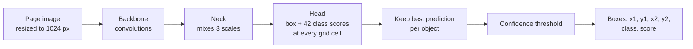

**Detection, step by step**

1. **Resize.** The page is scaled to the inference size (1024 px by default) and normalised.
2. **Backbone.** A stack of convolution layers turns the image into feature maps at three resolutions, one cell per
   8, 16 and 32 input pixels (the "strides" of the network). The fine map keeps the detail needed for small regions
   such as folios and page numbers; the coarse map sees large regions such as tables and whole columns.
3. **Neck.** The three maps are combined: coarse maps are upsampled and merged with finer ones (and the reverse), so
   every scale has both detail and context.
4. **Head.** At every cell of every map the head predicts, in the same pass, the box (its four edges, measured
   from the cell) and a score for each of the 42 classes. A page therefore produces thousands of candidate boxes.
5. **Choosing the final boxes.** Classic YOLO keeps the best candidate by *non-maximum suppression* (NMS): the
   highest-scoring box is kept and any box overlapping it by more than the IoU threshold is removed. YOLOv10 and
   YOLO26 are trained to give **one prediction per object**, so this step is not needed at inference
   ("NMS-free"). Finally, boxes whose best class score is below the **confidence threshold** are dropped.
6. **Output.** Each remaining box is a rectangle `(x1, y1, x2, y2)`, a class (one of the 42) and a score. These are
   the records the app shows and exports.

**Training, step by step**

1. **Ground truth.** Every training page has human-drawn rectangles with a class id. `yolo26/prepare_data.py`
   converts them to the YOLO format: class, centre and size, all relative to the page.
2. **Matching.** Each ground-truth box has to be assigned to the candidate predictions that should learn it.
   Ultralytics uses a *task-aligned assigner*: candidates whose cell lies inside the box and whose predicted box
   overlaps it well and whose class score is high get the box as their target; all other candidates are trained to
   predict "background". YOLOv10 and YOLO26 additionally train a second, one-to-one head so that only the single
   best candidate per object survives at inference, which is what removes NMS.
3. **Loss.** The error to minimise combines a **box loss** (how much the predicted box overlaps the ground truth,
   an IoU-based measure, plus a small direct coordinate term in YOLO26) and a **classification loss** (the
   predicted 42 scores against the true class). YOLOv10x also uses a distribution-based box term; YOLO26 predicts the
   box edges directly instead.
4. **Optimisation.** Pages are fed in batches with augmentation (mosaic of four pages, random scale, colour
   jitter; flips and rotation are switched off here because text must not be mirrored). Gradient descent updates all
   weights, the learning rate follows a cosine decay, and after every epoch the model is scored on the validation
   pages (mAP). The checkpoint with the best score is kept.
5. **Fine-tuning.** The models start from pretrained weights instead of random ones. YOLOv10x was pretrained on a
   UED-mini layout pages, and YOLO26x on COCO photographs; both are then trained on the IndicDLP pages so
   the final layer outputs the 42 layout classes.

**What is specific to document layout.** Regions are large, rectangular, tightly packed and strongly tied to their
position on the page, and some classes differ only by size or level (headline vs sub-headline). That is why
resolution matters (small page furniture), why headline and list levels get the lowest scores, and why
DocLayout-YOLO adds a module that looks at both page-level structure and small regions.

---

## 3. Dataset and label schema

The models were trained on **IndicDLP** (statistics below are as published for the whole dataset). This project is
scoped to **English and Bengali**: the app's interface and region names are provided in those two languages only.
The dataset files used here carry no per-page language field, so the detectors were trained on the full training split and cannot be
restricted to these two languages without a separate language filter.

| Property | Value |
|---|---|
| Pages | 119,806 high-resolution images |
| Annotations | 1,856,241 rectangular layout regions |
| Languages | Multilingual dataset; this project uses English and Bengali |
| Domains | 12 (novels, textbooks, magazines, acts and rules, research papers, manuals, brochures, syllabi, question papers, notices, forms, newspapers) |
| Sources | Digitally born and scanned documents |
| Labels | 42 physical and logical region classes |
| Annotation tool | Shoonya (open source, built on Label Studio) |

Share of the dataset's pages in the two languages used here (as published): English 9.1%, Bengali 7.6%.

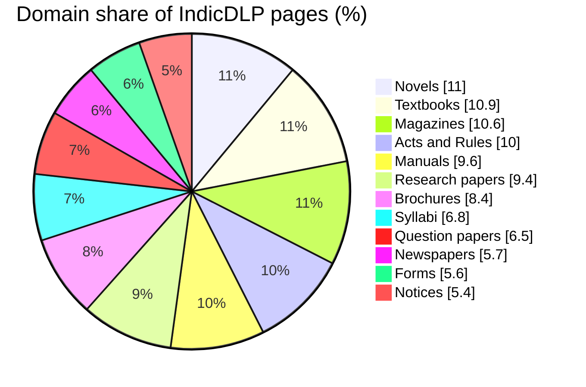

### 3.0 What this project actually used

| Item | Used here |
|---|---|
| YOLOv10x and DocLayout-YOLO | Released checkpoints, fine-tuned by their authors on IndicDLP; not re-trained here |
| YOLO26x training pages | 12,345 pages = 21 of 163 training shards (every eighth), about 13% of the training split |
| YOLO26x validation pages | 3,127 pages = 6 of 23 validation shards |
| Conversion | `yolo26/prepare_data.py` turns each page and its boxes into the YOLO text format (class, centre x, centre y, width, height, all relative to the page) |
| Language selection | None: the data files have no language field, so pages in all languages were used |

Sample pages are shown in [Section 3.2](#32-sample-annotated-pages-from-the-dataset).

### 3.1 The 42 region classes

For display, the app groups the classes into eight colour families so that related regions are visually related.

| Family | Classes |
|---|---|
| Headlines | headline, sub-headline, subsub-headline |
| Titles | chapter-title, section-title, sub-section-title, subsub-section-title |
| Body text | paragraph, quote, sidebar, author, reference, footnote |
| Lists | ordered-list, sub-ordered-list, subsub-ordered-list, unordered-list, sub-unordered-list, subsub-unordered-list |
| Figures and tables | figure, figure-caption, table, table-caption, formula, table-of-contents, index |
| Page furniture | header, footer, page-number, folio, flag, dateline, jumpline |
| Exam parts | first-level-question, second-level-question, third-level-question, options, answer |
| Other | advertisement, contact-info, placeholder-text, website-link |

### 3.2 Sample annotated pages from the dataset

These pages come from IndicDLP. Each coloured rectangle is a region drawn by a human annotator, and the tag above it
is its label. They show what the models are trained to reproduce. Only English and Bengali pages are shown, matching
the scope of this project.

| Bengali brochure (`br_bn_000817_1`) | Bengali form (`fm_bn_000220_0`) |
|:---:|:---:|
|  | 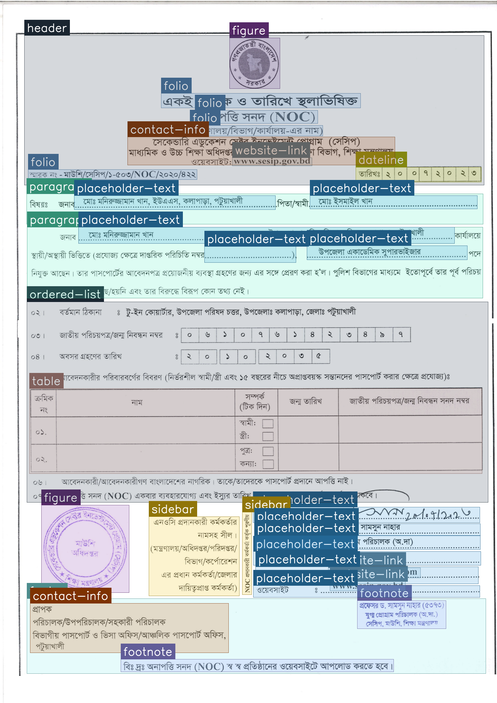 |
| A poster with a decorative `flag`, short `paragraph` text, a `dateline` and `contact-info`. | A form full of `placeholder-text` fields, a `table`, `figure` seals, a `sidebar` and `footnote`s. |

| Bengali newspaper (`np_bn_000047_0`) | Bilingual question paper (`qp_bn_000287_1`) |
|:---:|:---:|
| 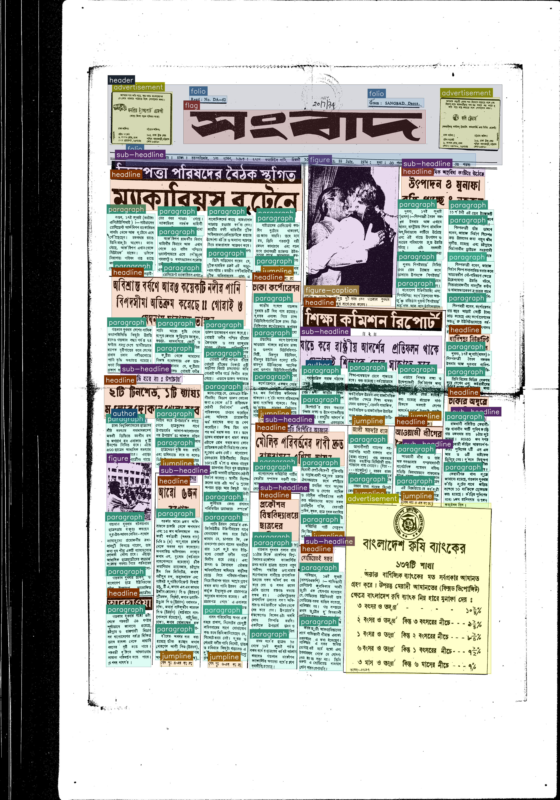 | 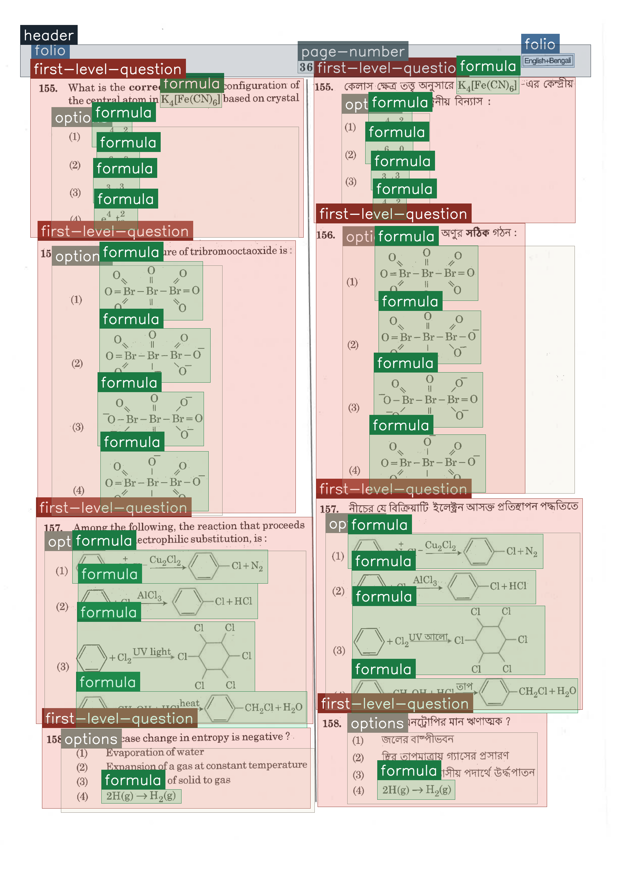 |
| A dense page: masthead `flag`, several headline levels, many `paragraph` columns, `figure`, `jumpline`s and `advertisement`s. | English and Bengali columns side by side, with `first-level-question`, `options` and many `formula` regions. |

| English research paper (`rp_en_001247_0`) |
|:---:|
| 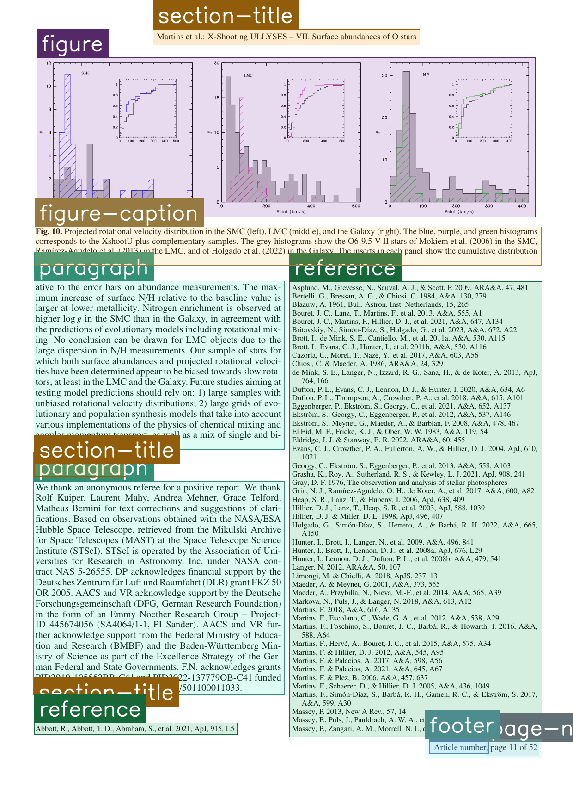 |
| A `figure` with its `figure-caption`, body `paragraph`s, `section-title`s, a `reference` list and a `footer`. |

### 3.3 Region counts per split

The table below lists how many regions of each of the 42 classes the training, validation and test splits contain.
Its totals (1,465,652 / 186,284 / 184,392) differ slightly from Table 3 of the arXiv version of the paper
(1,482,572 / 187,670 / 185,999), so the two probably come from different versions of the annotations. Paragraphs make up about a third of all regions, while classes such as
`subsub-unordered-list` (96 training regions), `index` (460) and `table-of-contents` (953) are rare. This imbalance is
one reason the rare classes get the lowest scores.

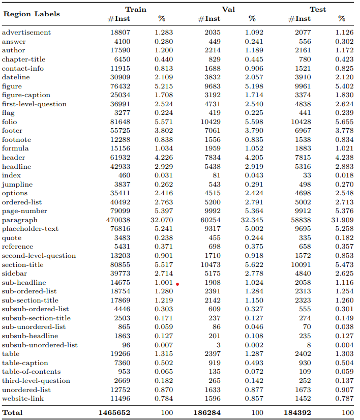

---

## 4. System design

### 4.1 Architecture

The system is a single-process Streamlit application. The user interface, the model registry, the inference
engine, the fusion module, the localisation module and the exporters are separate layers.

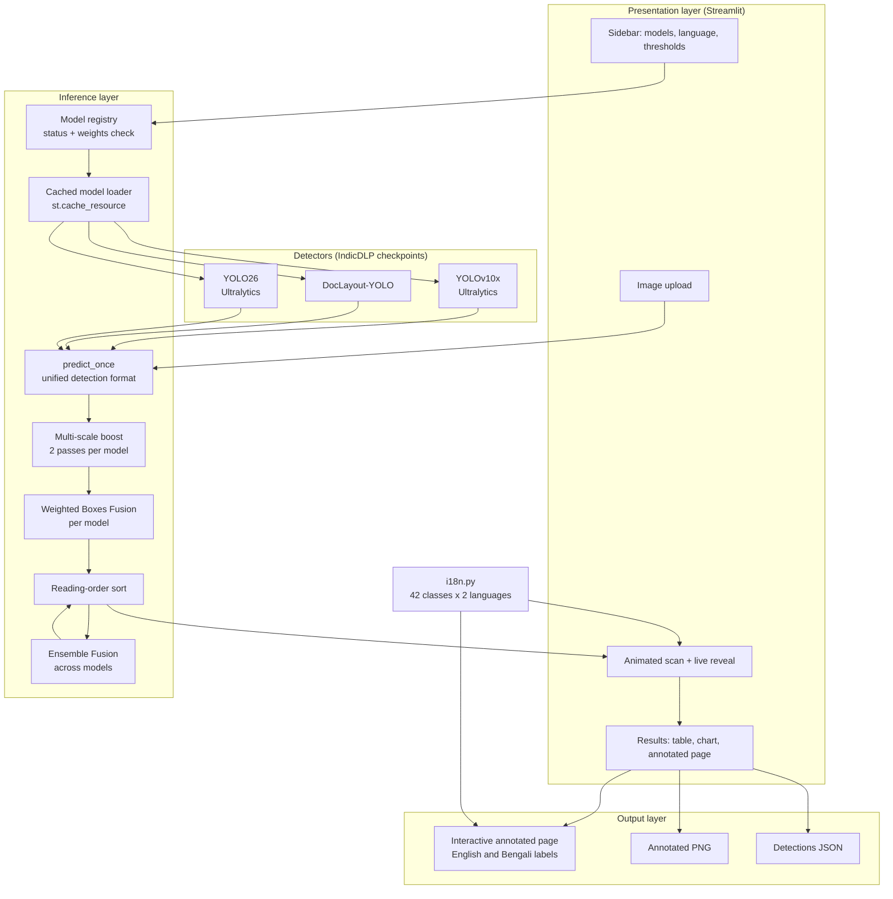

### 4.2 Components

| Component | File | Responsibility |
|---|---|---|
| Application and UI | `app.py` | Sidebar controls, animations, orchestration, results view, exports |
| Model registry | `app.py` (`MODELS`) | Names, checkpoint files, expected sizes, availability checks |
| Inference engine | `app.py` (`predict_once`, `run_model`) | Runs a model and converts its output to one common format |
| Fusion | `app.py` (`fuse`) | Weighted Boxes Fusion for scales and for models |
| Localisation | `i18n.py` | Names of all 42 classes in English and Bengali |
| Model code | `ultralytics`, `doclayout-yolo` (pip packages) | Upstream implementations required by those checkpoints |

### 4.3 Interaction sequence

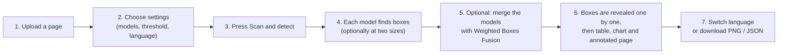

The language can be switched at step 7 without running the models again, because only the label text changes.

---

## 5. Methodology

### 5.1 End-to-end pipeline

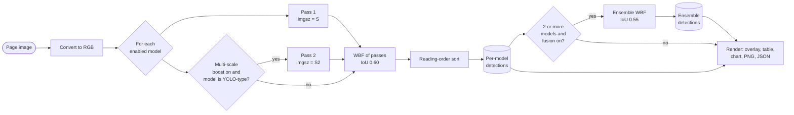

### 5.2 Detection and common format

Every model, whatever its framework, is wrapped so that it returns the same record per region:
`{box: (x1, y1, x2, y2), conf, cls, label}`. The YOLO-type models are called through their predict API with the user's
confidence threshold, NMS IoU and inference size.
This is what lets fusion, rendering and
export be written once.

### 5.3 Multi-scale boost

Small or faint regions (page numbers, folios, captions, datelines) are easily missed at a single resolution. When
the boost is enabled, each YOLO-type model is run twice: at the chosen size *S* (default 1024 px, the size used in
training) and at a second size *S₂* (1280 px, or 1024 px if *S* is already 1280). The two prediction sets are fused as
described below.

### 5.4 Weighted Boxes Fusion

Boxes are normalised to [0, 1] by the page width and height. For each class, boxes from all input sets are
clustered when their IoU exceeds a threshold (0.60 for scales, 0.55 for models). A fused box is the
confidence-weighted average of the cluster:

```
x_fused = ( Σᵢ sᵢ · xᵢ ) / ( Σᵢ sᵢ )        (same for y₁, x₂, y₂)
s_fused = max over the cluster of sᵢ         (conf_type = "max")
```

Predictions below the user's confidence threshold are dropped before fusion (`skip_box_thr`). Compared with NMS, this
uses information from every contributing box rather than keeping only one, which tends to tighten localisation when
models agree and keeps a region when only one model finds it.

### 5.5 Ensemble fusion

The same procedure is applied across the per-model results. The ensemble is therefore a *recall-oriented union with
averaged geometry* of the individual models, and is shown as its own result tab so it can be compared with each
constituent.

### 5.6 Reading order

Detections are sorted by the vertical position of their top edge, quantised into bands of 40 px, and then by their
left edge. This gives a natural top-to-bottom, left-to-right ordering used for the live reveal and for the JSON
output. It is a lightweight heuristic and is not a full reading-order model (see
[Limitations](#9-limitations-and-future-work)).

### 5.7 Localisation

Class names are stored once in English (the labels the models emit) and mapped to Bengali by
`i18n.py` at display time. Since only the display string changes, switching language never triggers inference.
The translations are concise conventional layout terms intended for display and should be reviewed by a native
speaker before formal use.

### 5.8 Engineering details

- **Caching:** loaded models are cached with `st.cache_resource`, so only the first scan pays the load and GPU
  warm-up cost.
- **Device selection:** CUDA is used when available, otherwise the CPU.
- **Robust weights handling:** each checkpoint is checked against its expected file size, so a partial download is
  reported instead of crashing the app.
- **Graceful degradation:** a model whose weights are missing is disabled with an explanation and the other models
  continue to work.

---

## 6. Input and output specification

### 6.1 Input

| Item | Details |
|---|---|
| Formats | PNG, JPG / JPEG, BMP, WebP |
| Source | Browser upload |
| Content | One page per run, in any supported language or domain |
| Resolution | Arbitrary. The models see the page at the *Inference size* (default 1024 px); exports use the original resolution |

### 6.2 Output

For every model, and for the ensemble, the system produces:

1. **Interactive annotated page.** Colour-coded boxes with labels in the chosen language and confidence on hover.
2. **Annotated PNG** at full resolution, labelled `class score` in English. On pages with more than 30 regions,
   `paragraph` labels are omitted to keep the image readable.
3. **Detections JSON**, one object per region in reading order:

```json
[
  {
    "box": [112.4, 530.0, 705.8, 1190.2],
    "conf": 0.9612,
    "cls": 21,
    "label": "paragraph",
    "name_local": "paragraph"
  }
]
```

| Field | Meaning |
|---|---|
| `box` | `[x1, y1, x2, y2]` in pixels of the original image |
| `conf` | Confidence score in [0, 1] |
| `cls` | Class index 0 to 41 |
| `label` | Class name in English |
| `name_local` | Class name in the selected display language |

The values shown are illustrative.

### 6.3 Configurable parameters

| Parameter | Role | Range | Default |
|---|---|---|---|
| Models | Which detectors run | YOLOv10x, DocLayout-YOLO, YOLO26x | All whose weights are present |
| Multi-scale boost | Second inference size, fused with the first | On / Off | On |
| Ensemble fusion | Fuse all models into one result | On / Off | On |
| Confidence threshold | Minimum score kept | 0.05 to 0.95, step 0.05 | 0.25 |
| NMS IoU | Duplicate-removal overlap threshold | 0.10 to 0.95, step 0.05 | 0.70 |
| Inference size | Input resolution in pixels | 640, 800, 1024, 1280 | 1024 |
| Region-name language | Language of the class names | English, Bengali | English |
| Reveal speed | Animation pace only, no effect on results | Cinematic, Normal, Fast, Instant | Normal |

The reveal speed sets how long the box-by-box animation takes for a page: about 6 s (Cinematic), 3 s (Normal),
1.2 s (Fast) or no delay (Instant), with at most 0.6 s between two boxes. The *Reset to defaults* button restores
every value above.

---

## 7. Experiments and results

### 7.1 Benchmark accuracy of the detectors

Accuracy is the COCO-style mAP averaged over IoU 0.50 to 0.95 (mAP[50:95]).

| Model | mAP[50:95] | Source | How it was obtained |
|---|---|---|---|
| YOLOv10x | 57.7 | IndicDLP paper [4], Table 6 | Published; the model pretrained on UED-mini, then fine-tuned on IndicDLP |
| DocLayout-YOLO | 54.5 | IndicDLP paper [4], Table 4 | Published; fine-tuned on IndicDLP |
| YOLO26x | 43.4 | This project | Measured with `yolo26/evaluate.py` on 3,127 validation pages at 1024 px |

Notes on reading the table:

- The two published figures are copied from the paper. They were not re-measured here. The paper does not state
  whether they were computed on the validation or the test split.
- For comparison, the paper reports 55.0 for YOLOv10x without UED-mini pretraining (Table 4), so the pretraining adds
  about two to three points.
- The YOLO26x figure comes from a subset of the validation split and a different training set size, so it is not a
  like-for-like comparison with the published figures.

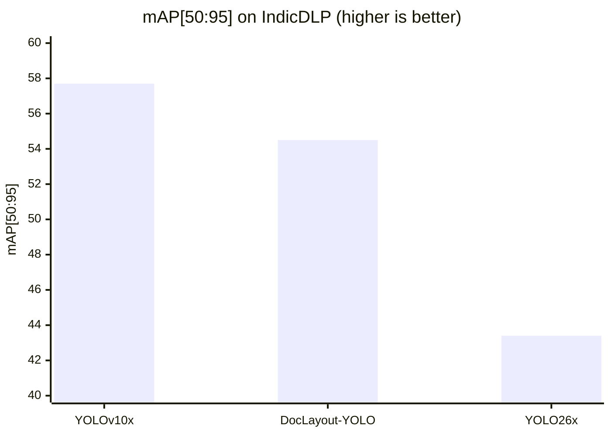

The ensemble stage has no published benchmark figure. Its effect can be inspected per page through the comparison
table in the app (regions found, classes found, average confidence, time).

<a id="yolo26-training"></a>
#### YOLO26 training

YOLO26x is fine-tuned on the 12,345 training pages with `yolo26/train.py` (data from `yolo26/prepare_data.py`,
scored with `yolo26/evaluate.py`). Settings: COCO-pretrained `yolo26x.pt`, 1024 px, batch 2, 40 epochs, cosine
learning rate, no flips or rotation, mosaic closed for the last 8 epochs.

| Metric | Value |
|---|---|
| mAP[50:95] | 43.4 |
| mAP50 | 61.2 |
| Precision | 64.5 |
| Recall | 59.5 |

**Why YOLO26x scores lower than YOLOv10x.** The reasons below are listed in the order they are expected to matter.
They have not been separated by experiments here.

- **Less training data.** YOLO26x saw only about 13% of IndicDLP's training pages (every eighth shard: 21 of 163, which
  is 12,345 pages). The published checkpoints were presumably fine-tuned on the full training split (not verified here).
- **Different pretraining.** YOLOv10x was first pretrained on UED-mini layout pages. YOLO26x started from COCO
  photographs only.
- **Rare classes.** About half of the 42 classes have under 1,000 training boxes in this subset, and they score lowest.
- **Small batch.** A batch of 2 is a weak training recipe compared with the larger batches typical for this model size.

**Per-class scores for YOLO26x (mAP[50:95]).**

- Strongest: table 82, paragraph 82, figure 74, headline 71, unordered-list 67.
- Weakest: subsub-headline 3, subsub-section-title 7, answer 13, quote 13, sub-unordered-list 16,
  sub-section-title 18.

**Where the trained checkpoint is.** The checkpoint (118 MB) is larger than GitHub's 100 MB file limit and is
therefore not in the repository. The app works without it, using the other two models. To obtain it, YOLO26x has to be
trained again, as described next.

#### How to train YOLO26x

**1. Get the data.** The dataset is [`ai4bharat/indicdlp`](https://huggingface.co/datasets/ai4bharat/indicdlp) on
Hugging Face, stored as Parquet files named `train-NNNNN-of-00163` and `validation-NNNNN-of-00023` inside a `data/`
folder. The paper and project page are linked in [References](#11-references). The download tool is installed with the
project requirements (`huggingface_hub`).

```bash
# Option A: the whole dataset (very large: it is made of page images)
hf download ai4bharat/indicdlp --repo-type dataset --local-dir indicdlp_raw

# Option B: the subset used for the reported result (every eighth training shard, six validation shards)
for i in $(seq 0 8 160); do
  hf download ai4bharat/indicdlp --repo-type dataset --local-dir indicdlp_raw \
     --include "data/train-$(printf '%05d' $i)-of-00163*"
done
for i in 00000 00005 00010 00014 00018 00022; do
  hf download ai4bharat/indicdlp --repo-type dataset --local-dir indicdlp_raw \
     --include "data/validation-$i-of-00023*"
done
```

**2. Convert it to YOLO format.** `prepare_data.py` reads the Parquet files and writes one image and one text label file
per page (class, centre x, centre y, width, height, all relative to the page), plus the `indicdlp.yaml` that points to
them.

```bash
python yolo26/prepare_data.py --raw indicdlp_raw/data --out indicdlp_yolo
```

**3. Train.** `train.py` downloads the COCO-pretrained `yolo26x.pt` automatically on the first run.

```bash
python yolo26/train.py --data indicdlp_yolo/indicdlp.yaml --model yolo26x.pt --epochs 40 --batch 2 --close-mosaic 8
```

- Settings used: 1024 px images, 40 epochs, cosine learning rate, no flips or rotation, mosaic closed for the last
  8 epochs.
- Training on the subset took about 20 hours; using every shard would take roughly eight times longer.
- The best checkpoint is copied to `weights/yolo26_indicdlp.pt`, the file the app loads.
- An interrupted run continues with
  `python yolo26/train.py --resume --name yolo26_indicdlp --data indicdlp_yolo/indicdlp.yaml`.

**4. Measure it.**

```bash
python yolo26/evaluate.py --data indicdlp_yolo/indicdlp.yaml
```

This prints mAP[50:95], mAP50, precision and recall on the validation pages.

### 7.2 Demonstration: input and output

Two archival newspaper pages were run through the app with its default settings. The output is the **Ensemble Fusion**
result: the boxes of the enabled models merged with Weighted Boxes Fusion. Each box carries the label of its region
and the model's confidence (0 to 1).

#### Demo 1: English newspaper (*Amrita Bazar Patrika*, 15 August 1947)

| Input | Output |
|:---:|:---:|
| 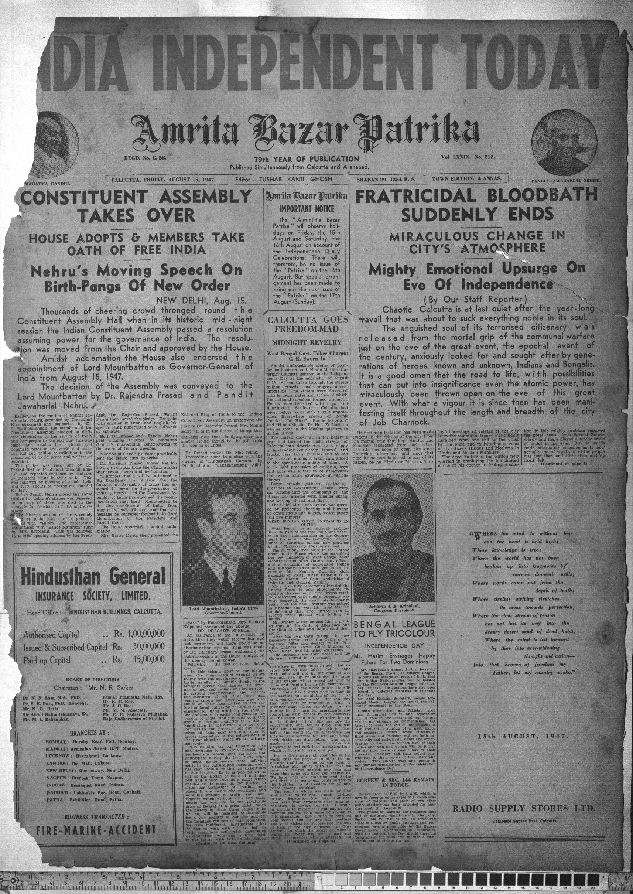 | 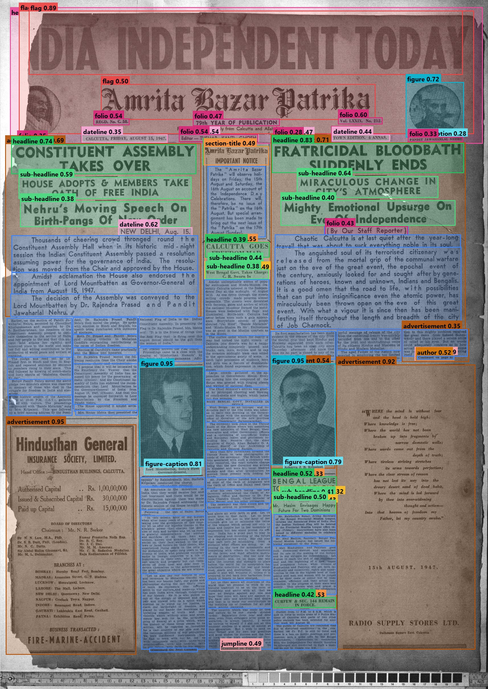 |

What the output shows:

- The banner headline "India Independent Today" is found as a `flag` (0.89), and the newspaper title as a second `flag` (0.50).
- The main headlines are found as `headline` (0.74 and 0.83), with their sub-headlines as `sub-headline` (0.38 to 0.64).
- Both photographs are `figure` (0.95), each with its `figure-caption` (0.81 and 0.79), and the two round portraits at the
  top are also found as `figure`.
- The Hindusthan General Insurance box is an `advertisement` (0.95). The poem and the advertisement below it on the right
  appear to be covered by a single `advertisement` box (0.92).
- Body text is found as many `paragraph` boxes (blue), including the narrow columns at the bottom.
- Small page furniture such as the registration line, volume and issue, and date line is found as `folio` and `dateline`
  boxes, with lower confidence (about 0.28 to 0.62).

#### Demo 2: Bengali newspaper page

| Input | Output |
|:---:|:---:|
| 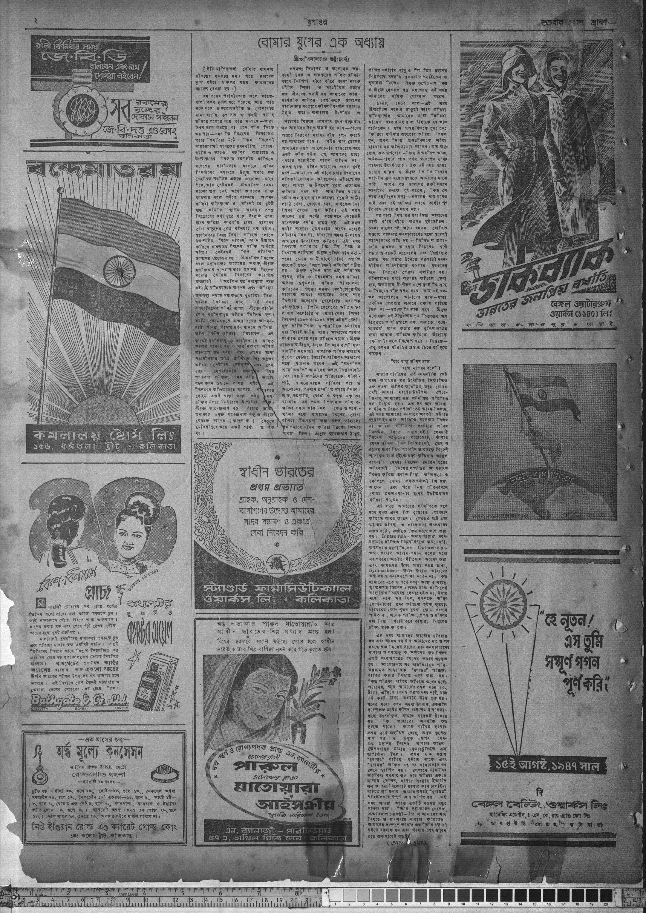 | 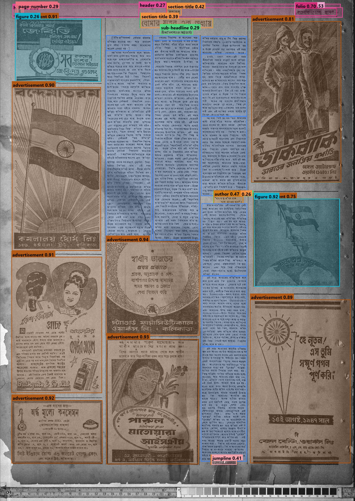 |

What the output shows:

- Seven of the large advertisements around the text are detected as `advertisement` (0.81 to 0.94). The small advertisement at
  the top left is labelled `figure` (0.26) instead, which is a mistake.
- The two flag illustrations are found: one as part of an `advertisement`, one as a `figure` (0.92).
- The three text columns are found as `paragraph` boxes (blue). The article title is a `section-title` (0.39 and 0.42) and the
  author line a `sub-headline` (0.29).
- The page header is found as `header`, `folio` (0.70) and `page-number` (0.29), and the "continued" line at the bottom as
  `jumpline` (0.41).

Both pages are old, low-contrast scans with stains and torn edges. The large, distinctive regions (photographs,
advertisements, headlines, body columns) receive high confidence, while small page furniture and headline levels receive
low confidence and are the least reliable, as the per-class scores in Section 7.1 also show.

### 7.3 Discussion

The per-class scores above show the same pattern for YOLO26x: large, visually distinctive regions (table, paragraph,
figure, headline) score high, while hierarchy-dependent classes (headline levels, list levels, question levels) and
rare classes score low. This is the trade-off that the *Multi-scale boost* and *Ensemble fusion* options are meant to
address, and the app lets the user observe it directly by toggling them and comparing the result tabs.

---

## 8. Installation and usage

### Guide for evaluators

This section is the fastest route to a working demo.

1. **What to expect.** A web app that detects layout regions on a document page with up to three models, fuses
   their outputs, and shows labels in English and Bengali. It runs in a browser at `http://localhost:8501`.
2. **Minimum setup (about 10 minutes plus downloads).** Follow the Quick start below. Only YOLOv10x and
   DocLayout-YOLO are needed; they run on a normal laptop, with or without a GPU.
3. **Weights.** About 225 MB for the two YOLO models. The app downloads them with one click on first launch.
4. **Try it.** Upload a document page, press *Scan & detect*, then switch the *Region names* language.
5. **If something fails,** see [Troubleshooting](#step-10-troubleshooting).

### Quick start (YOLOv10x and DocLayout-YOLO)

```powershell
git clone <repository-url>
cd <project-folder>
python -m venv .venv
.\.venv\Scripts\Activate.ps1          # Linux/macOS: source .venv/bin/activate
pip install torch torchvision --index-url https://download.pytorch.org/whl/cu128   # CPU only: pip install torch torchvision
pip install -r requirements.txt
python -m streamlit run app.py        # then open http://localhost:8501 and click "Download weights"
```

The detailed steps follow.

### Step 1: Requirements

- **Git** ([download](https://git-scm.com/downloads))
- **Python 3.10 or newer** ([download](https://www.python.org/downloads/)), tested on 3.14.
  When installing on Windows, tick **"Add python.exe to PATH"**.
- About **2 GB of free disk space** (PyTorch is the biggest part)
- An **NVIDIA GPU is recommended** but not required. Without one the app runs on the CPU, just more slowly.
- Internet access for the install and the first weight download

Check that everything is installed:

```bash
git --version
python --version
```

### Step 2: Clone the repository

```bash
git clone <repository-url>
cd <project-folder>
```

> Replace `<repository-url>` with the address of this repository and `<project-folder>` with the folder name that
> `git clone` creates.

All the following commands are run **from inside this project folder**.

### Step 3: Create a virtual environment

A virtual environment keeps this project's packages separate from the rest of the system.

**Windows (PowerShell):**

```powershell
python -m venv .venv
.\.venv\Scripts\Activate.ps1
```

If PowerShell blocks the activation script, run this once and try again:
`Set-ExecutionPolicy -Scope CurrentUser RemoteSigned`

**Linux / macOS:**

```bash
python3 -m venv .venv
source .venv/bin/activate
```

The terminal prompt now starts with `(.venv)`. The remaining steps are done in this same terminal.

### Step 4: Install PyTorch

Install PyTorch **first**, because the right build depends on the hardware. **One** line is chosen:

```bash
# NVIDIA GPU (CUDA 12.8)
pip install torch torchvision --index-url https://download.pytorch.org/whl/cu128

# CPU only (or macOS)
pip install torch torchvision
```

For other CUDA versions, use the selector on <https://pytorch.org/get-started/locally/>.

### Step 5: Install the other requirements

```bash
pip install -r requirements.txt
```

This installs Streamlit, Ultralytics (YOLOv10), DocLayout-YOLO, ensemble-boxes, Pillow, NumPy and OpenCV.

### Step 6: Get the model weights

The weight files live in the `weights/` folder. They are large, so they are **not** stored in the git repository.

| File | Model | Size |
|---|---|---|
| `md2_PT_indicdlp_FT.pt` | YOLOv10x | 64 MB |
| `doclayout_yolo_indicdlp.pt` | DocLayout-YOLO | 161 MB |
| `yolo26_indicdlp.pt` | YOLO26x (trained with `yolo26/train.py`, see [YOLO26 training](#yolo26-training)) | 118 MB |

**Easiest way:** skip this step. When the app starts (step 7), any missing model shows a
**⬇ Download weights** button in the sidebar.

**Manual download:**

```bash
mkdir weights
curl -L -C - -o weights/md2_PT_indicdlp_FT.pt "https://zenodo.org/records/15881917/files/md2_PT_indicdlp_FT.pt?download=1"
curl -L -C - -o weights/doclayout_yolo_indicdlp.pt "https://zenodo.org/records/15881917/files/doclayout_yolo_indicdlp.pt?download=1"
```

On Windows PowerShell, use `curl.exe` instead of `curl`, and `New-Item -ItemType Directory -Force weights` instead of `mkdir weights`.

`-C -` resumes an interrupted download. Zenodo can be slow, so be patient. The app ignores partly downloaded files,
so an unfinished download will not crash it.

All checkpoints were checked and the two YOLOv10-based models load and detect.

### Step 7: Run the app

```bash
python -m streamlit run app.py
```

The app opens at **http://localhost:8501**. If the browser does not open by itself, the address can be pasted into it.
To stop the app, press `Ctrl + C` in the terminal.

**To start it again later:** open a terminal in the project folder, activate the environment again
(step 3, the `Activate` / `source` line only), then run the command above.

### Step 8: Using the app

1. Upload a page image (PNG, JPG, JPEG, BMP or WEBP).
2. Click **🚀 Scan & detect**.
3. Watch the scan, then each model's regions appear one by one with a live feed, stats and a progress bar.
4. Scroll to **Results** for the comparison table, the per-class chart and the annotated page. Use the model tabs,
   and the **Download** buttons for a PNG or JSON export. Hover over a box to see its label and confidence.
5. Change the language in the sidebar (**Region names**) to see the labels in Bengali.
   This updates the results instantly without re-running the models.

### Step 9: Sidebar settings

| Setting | What it does | Default |
|---|---|---|
| Model toggles | Choose which models run | All models with weights present are on |
| Language | Language of region names | English |
| Multi-scale boost | Runs each model at two sizes and merges the boxes, so small or faint regions are found more often (slower) | On |
| Ensemble fusion | Merges all enabled models into one extra result | On |
| Confidence threshold | Minimum score for a box (0.05 to 0.95). Lower finds more regions but adds false boxes | 0.25 |
| NMS IoU | Controls removal of overlapping duplicate boxes (0.10 to 0.95). Higher keeps more overlapping boxes | 0.70 |
| Inference size | Image size the model sees: 640, 800, 1024 or 1280. 1024 is what the models were trained at; larger sizes help small regions but are slower | 1024 |
| Reveal speed | How fast boxes appear in the animation: Cinematic, Normal, Fast or Instant | Normal |
| Reset to defaults | Restores the values above | - |

### Step 10: Troubleshooting

| Problem | Fix |
|---|---|
| `python` or `git` is not recognised | Install it, then open a **new** terminal. On Windows, tick "Add to PATH" in the Python installer. |
| PowerShell blocks `Activate.ps1` | Run `Set-ExecutionPolicy -Scope CurrentUser RemoteSigned`, then activate again. |
| `No module named ...` (for example `doclayout_yolo`, `huggingface_hub`, `ensemble_boxes`) | The environment is not active, or step 5 did not finish. Activate `.venv` and run `pip install -r requirements.txt` again. |
| "Weights not downloaded" / "Weights incomplete" | Finish step 6, or use the **⬇ Download weights** button in the sidebar. |
| The first scan takes about 15 seconds | Normal: the GPU warms up once. Later scans are fast. |
| Scans are slow | Turn off *Multi-scale boost*, or switch off one model. |
| No GPU found | The app falls back to the CPU automatically. The sidebar shows the device in use. |
| Port 8501 already in use | `python -m streamlit run app.py --server.port 8502` |
| Bengali labels show as empty squares | The system needs a Bengali-capable font (Windows has *Nirmala UI* built in). |

### Setup summary for each model

| Model | Needs | Works on | Setup |
|---|---|---|---|
| YOLOv10x | `ultralytics` + PyTorch | Windows, Linux, macOS; GPU or CPU | Steps 4 to 6 (weights: `md2_PT_indicdlp_FT.pt`) |
| DocLayout-YOLO | `doclayout-yolo` + PyTorch | Windows, Linux, macOS; GPU or CPU | Steps 4 to 6 (weights: `doclayout_yolo_indicdlp.pt`) |
| YOLO26 | `ultralytics>=8.4` + PyTorch | Windows, Linux, macOS; GPU or CPU | Train with `yolo26/train.py` (weights: `yolo26_indicdlp.pt`) |

All models share one environment (steps 3 to 5).

---

## 9. Limitations and future work

**Limitations**

- **Boxes only.** Output is rectangular bounding boxes, not polygons, so slanted or irregular regions are
  approximated.
- **Heuristic reading order.** The ordering sorts by position in bands. It can mis-order complex layouts such as
  multi-column pages with spanning headlines or wrapped figures.
- **Limited training.** YOLOv10x and DocLayout-YOLO use the published checkpoints; only YOLO26x was trained here, and it is the weakest of the three. The
  contribution of multi-scale and ensemble fusion has not been benchmarked on the full test set.
- **Hierarchical classes.** Distinguishing headline levels, list levels and question levels depends on subtle size
  cues and gives the lowest per-class scores.
- **Translations.** The Bengali labels are for display and need native-speaker review before formal use.
- **One page at a time.** There is no multi-page PDF handling.

**Future work**

- Quantitative evaluation of multi-scale and ensemble fusion on the IndicDLP test split, with per-class AP.
- Tuned per-model fusion weights instead of equal weighting.
- Multi-page PDF input and batch processing.
- A learned reading-order model and hand-off of detected regions to OCR for Bengali.
- Additional export formats (COCO JSON, PAGE-XML, HTML).

---

## 10. Project structure

| Path | What it is |
|---|---|
| `app.py` | The Streamlit app: animations, live reveal, multi-scale inference, ensemble fusion, localised results, exports |
| `i18n.py` | Names for all 42 classes in English and Bengali |
| `requirements.txt` | Python dependencies for the app |
| `weights/` | Model checkpoints (downloaded separately, not in git) |
| `docs/images/` | Sample annotated dataset pages and the class-count table shown in Section 3 |
| `yolo26/` | Scripts to prepare the data, train and evaluate YOLO26 |

---

## 11. References

### 11.1 Libraries

[Ultralytics YOLOv10](https://github.com/ultralytics/ultralytics),
[DocLayout-YOLO](https://github.com/opendatalab/DocLayout-YOLO),
[ensemble-boxes](https://github.com/ZFTurbo/Weighted-Boxes-Fusion), [Streamlit](https://streamlit.io) and PyTorch.

### 11.2 References

1. A. Wang, H. Chen, L. Liu, et al. *YOLOv10: Real-Time End-to-End Object Detection.* NeurIPS 2024.
2. Z. Zhao, H. Kang, B. Wang, C. He. *DocLayout-YOLO: Enhancing Document Layout Analysis through Diverse Synthetic
   Data and Global-to-Local Adaptive Perception.* arXiv:2410.12628, 2024.
3. R. Solovyev, W. Wang, T. Gabruseva. *Weighted Boxes Fusion: Ensembling boxes from different object detection
   models.* Image and Vision Computing, 2021.
4. O. Nath, S. Kukkala, M. Khapra, R. K. Sarvadevabhatla. *IndicDLP: A Foundational Dataset for Multi-Lingual and
   Multi-Domain Document Layout Parsing.* arXiv:2512.20236, 2025.
   [arXiv](https://arxiv.org/abs/2512.20236), [project page](https://indicdlp.github.io/),
   [dataset](https://huggingface.co/datasets/ai4bharat/indicdlp).
5. T.-Y. Lin, M. Maire, S. Belongie, et al. *Microsoft COCO: Common Objects in Context.* ECCV 2014 (the photograph
   collection used to pretrain YOLO26x).
