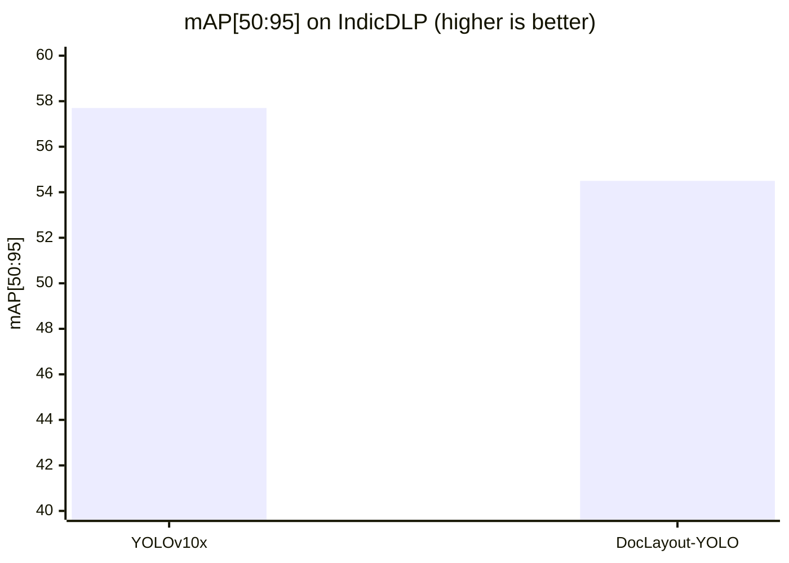
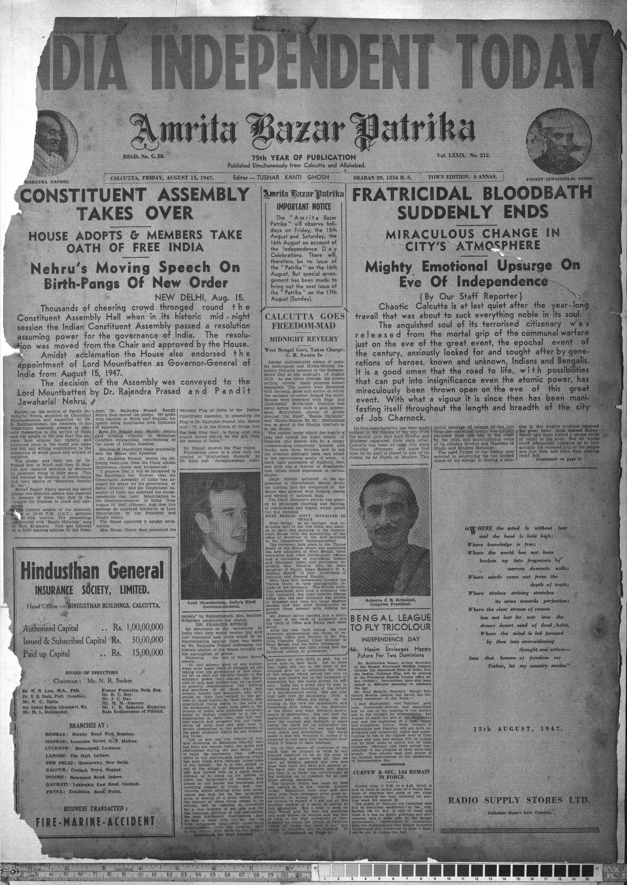
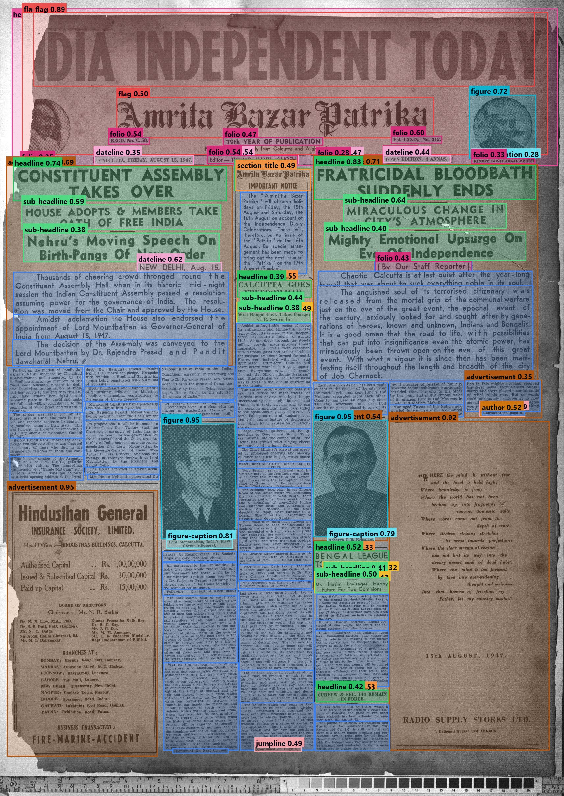
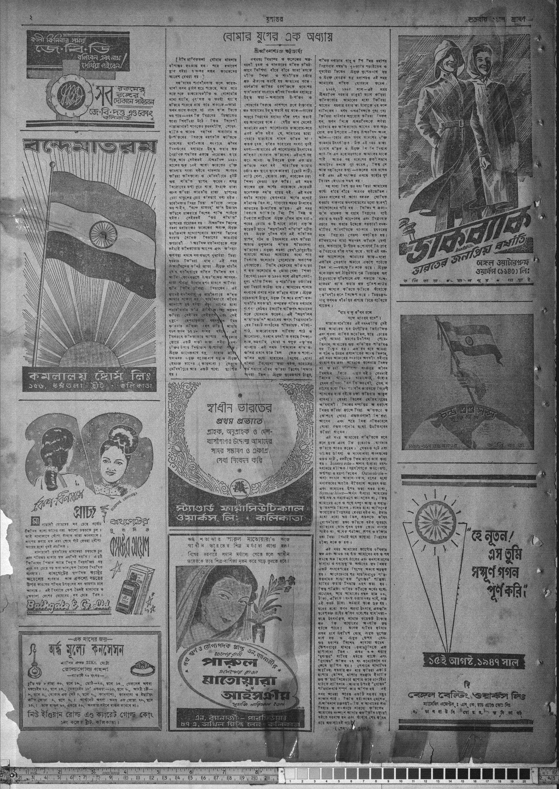
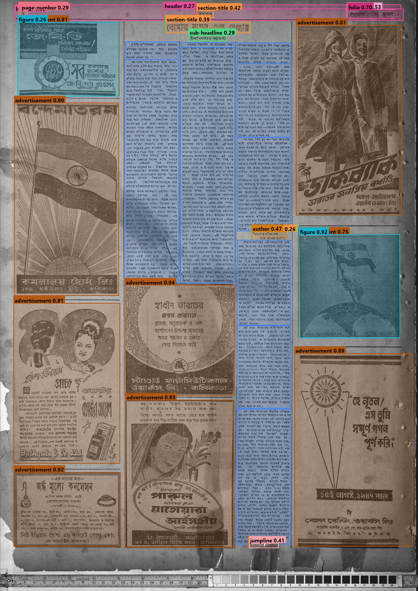
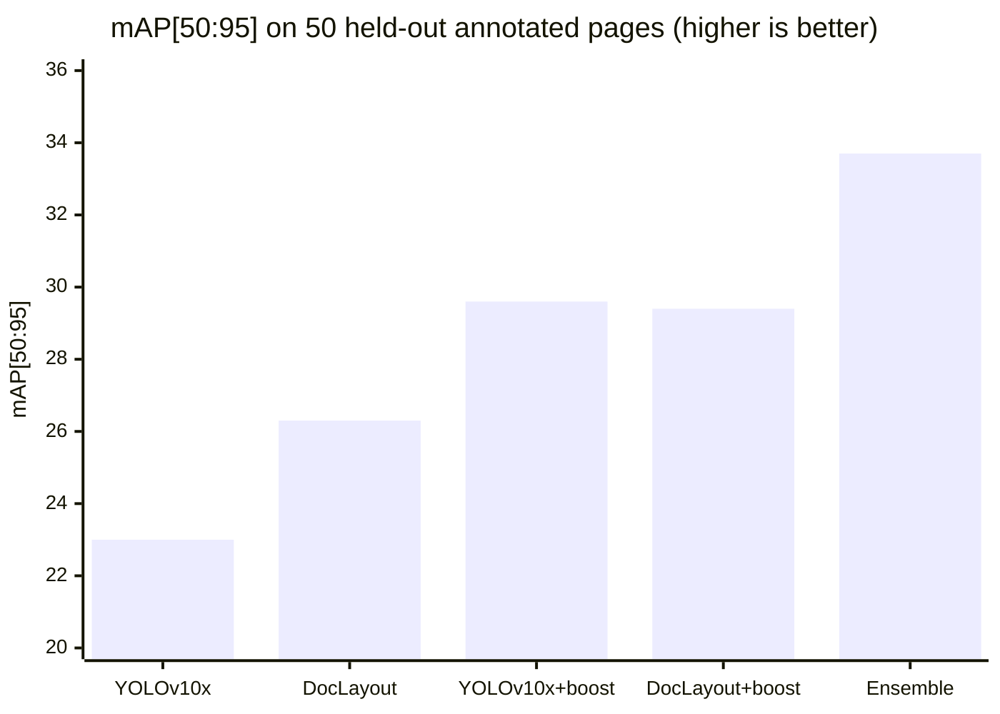

<div align="center">

# &nbsp;

*(Project title intentionally left blank)*

**Rajdip Dhar**
Computer Science and Engineering, Heritage Institute of Technology

**Period of Internship:** 21st September 2026 - 30th November 2026

Report submitted to: **IDEAS - Institute of Data Engineering, Analytics and Science Foundation, ISI Kolkata**

**Project Mentor:** Dr. Sujoy Kumar Biswas

</div>

---

## Contents

1. [Abstract](#1-abstract)
2. [Introduction](#2-introduction)
3. [Project Objective](#3-project-objective)
4. [Methodology](#4-methodology)
5. [Data Analysis and Results](#5-data-analysis-and-results)
6. [Conclusion](#6-conclusion)
7. [Appendices](#7-appendices)

---

## 1. Abstract

Document layout analysis locates and labels the regions of a page (headlines, paragraphs, figures, tables, page furniture), and it is the first step of almost every document-digitisation pipeline.
For Bengali and English pages it is hard, because the Bengali script is complex, pages are multi-column and mixed-script, and archival scans are degraded.
The public IndicDLP dataset (119,806 pages, 42 region classes) and its fine-tuned detectors solve the modelling part, but they are released only as research checkpoints with no user interface.
This project builds a web application, the Live Layout Studio, that puts two of these detectors (YOLOv10x and DocLayout-YOLO) behind one interface.
It adds multi-scale inference and Weighted Boxes Fusion to merge several passes or models into one prediction.
It animates detection region by region, shows the 42 class names in English, Bengali and ten other Indic languages, and reads the text of each region with OCR (Gemini or EasyOCR).
Multi-page PDFs can be processed as a batch, and results export as PNG, JSON, COCO JSON, PAGE-XML, HTML and text in reading order.
The published checkpoints (57.7 and 54.5 mAP[50:95]) are used as released, and one of them is also fine-tuned on annotated Bengali newspaper pages.
On 50 held-out, human-annotated Bengali newspaper pages the ensemble reached 33.7 mAP[50:95] against 29.6 and 29.4 for the two boosted single models, at about 0.39 s per page on a GPU.
The system makes layout detectors usable and inspectable, and its limits are listed for future work.

---

## 2. Introduction

### 2.1 Relevance

To a computer, a scanned newspaper or textbook page is only a picture.
Layout analysis turns it into a list of **boxes**, each a rectangle `(x1, y1, x2, y2)` with a label such as `headline`, `paragraph`, `figure` or `table` and a confidence score.
This list is needed before text can be read, searched, indexed or made accessible.
India has a very large body of Bengali and other Indic print, much of it archival, and layout models trained mostly on English scientific papers transfer poorly to it.

### 2.2 Technology involved

| Area | Technology |
|---|---|
| Detectors | YOLOv10x (Ultralytics) and DocLayout-YOLO, single-stage object detectors, using the IndicDLP-fine-tuned checkpoints |
| Fusion | Weighted Boxes Fusion (`ensemble-boxes`) |
| Text reading (OCR) | Google Gemini (cloud) and EasyOCR (local, Bengali + English) |
| Super-resolution | ESPCN x2 (OpenCV) to sharpen small cutouts |
| PDF input | PyMuPDF renders each PDF page to an image |
| Reading order and exports | Recursive XY-cut; COCO JSON, PAGE-XML and HTML writers; per-class AP (`detmetrics.py`) |
| Interface | Streamlit with a custom JavaScript component for clickable boxes |
| Runtime | Python, PyTorch (CUDA or CPU), Pillow, NumPy, OpenCV |

### 2.3 Background material survey

- **IndicDLP** (Nath et al., 2025): 119,806 pages from 12 document types, 1,856,241 human-drawn boxes, 42 classes, built with the Shoonya annotation tool. It is the dataset the checkpoints were trained on.
- **YOLOv10** (Wang et al., NeurIPS 2024): a real-time detector trained to give one prediction per object, so it needs no non-maximum suppression (NMS). The YOLOv10x checkpoint was pretrained on UED-mini (about 75,000 pages from DocLayNet and M6Doc) and then fine-tuned on IndicDLP.
- **DocLayout-YOLO** (Zhao et al., 2024): a YOLOv10-derived detector for documents, pretrained on synthetic layout pages and adding a Global-to-Local Controllable Receptive Module for page-level structure and small regions.
- **Weighted Boxes Fusion** (Solovyev et al., 2021): instead of discarding overlapping boxes as NMS does, it averages the coordinates of overlapping boxes of the same class, weighted by confidence.

### 2.4 Procedure used

Two released detectors were wrapped so that both return the same record per region. Their outputs were combined by multi-scale inference and WBF. The results were put behind an interactive Streamlit interface with language switching, OCR and export. The pipeline was then benchmarked on sample pages, evaluated against 100 human-annotated newspaper pages, and one detector was fine-tuned on part of them. Section 4 gives the details.

### 2.5 Purpose

To make state-of-the-art Indic layout detectors easy to run, compare and inspect, so that a researcher or archivist can drop in a page, see what each model finds, and judge where a prediction may be wrong.

### 2.6 Topics covered in the first two weeks of training

> **TO BE FILLED BY THE STUDENT before submission.** The template requires the list of topics taught in the first two weeks of the internship (21 Sep - 4 Oct 2026). This information is not recorded in the project files, so it has not been guessed here.
>
> 1. *(topic)*
> 2. *(topic)*
> 3. *(topic)*

---

## 3. Project Objective

1. To build a single web interface over two IndicDLP layout detectors (YOLOv10x and DocLayout-YOLO) for English and Bengali document pages.
2. To improve recall on small and faint regions by multi-scale inference and ensemble fusion (Weighted Boxes Fusion), and to measure its effect against the single models.
3. To make detection observable: a live region-by-region reveal, clickable boxes with coordinates and cutouts, and class names in English, Bengali and ten other Indic languages without re-running the models.
4. To extract the text of each region with OCR (Gemini or EasyOCR) and to support multi-page PDF input, batch processing and export as PNG, JSON, COCO JSON, PAGE-XML, HTML and reading-order text.
5. To benchmark the models and measure per-class AP of the single models, the multi-scale boost and ensemble fusion (with tuned fusion weights) on human-annotated pages, and to report the limitations honestly.

*Hypothesis testing: none was carried out. Sample survey: none was conducted, so there is no target population.*

---

## 4. Methodology

### 4.1 Overall workflow

```mermaid
flowchart LR
    A["Study IndicDLP, YOLOv10,<br/>DocLayout-YOLO, WBF"] --> B["Obtain released checkpoints<br/>(Zenodo)"]
    B --> C["Unified wrapper:<br/>box, conf, class, label"]
    C --> D["Multi-scale boost<br/>1024 px + 1280 px"]
    D --> E["WBF per model<br/>IoU 0.60"]
    E --> F["Ensemble WBF<br/>across models, IoU 0.55"]
    F --> G["Reading order<br/>(XY-cut)"]
    G --> H["Streamlit UI:<br/>PDF, batch, reveal, click"]
    H --> I["OCR, ESPCN upscale,<br/>PNG / JSON / COCO / PAGE-XML / HTML / TXT"]
    I --> J["benchmark.py and<br/>evaluate_fusion.py"]
```



### 4.2 Steps carried out

1. **Literature and dataset study.** Read the IndicDLP, YOLOv10, DocLayout-YOLO and WBF papers; studied the 42-class schema and the annotation guideline (`guidelines/`).
2. **Model acquisition.** Downloaded the two released checkpoints (`md2_PT_indicdlp_FT.pt`, 64 MB; `doclayout_yolo_indicdlp.pt`, 161 MB) with a size check, so a partial download is reported instead of crashing the app.
3. **Unified detection layer.** Each model is wrapped so it returns `{box (x1,y1,x2,y2), conf, cls, label}`. Fusion, rendering and export are therefore written once.
4. **Multi-scale boost.** Each YOLO-type model runs at size S (1024 px, the training size) and at S2 (1280 px). The two prediction sets are fused.
5. **Weighted Boxes Fusion.** Boxes are normalised to [0,1]. Same-class boxes are clustered when IoU exceeds 0.60 (scales) or 0.55 (models). A fused box is the confidence-weighted average of its cluster, and its score is the cluster maximum.
6. **Reading order.** A recursive XY-cut (`layout_order.py`) splits the page at the widest empty band, relative to the page size: stacked sections are read top to bottom and columns left to right, so a full-width headline precedes the columns beneath it. It replaces the earlier 40 px band sort. It is a geometric rule, **not** a learned model.
7. **Localisation.** Class names are stored once in English and translated at display time by `i18n.py`, so changing language never triggers inference.
8. **Interface.** Streamlit app with a file manager, sample gallery, model toggles, confidence / NMS-IoU / inference-size controls, a simplified six-family class view, and a custom component for clickable boxes.
9. **OCR and enhancement.** A Gemini request per region (with model fallback) or local EasyOCR reads text-bearing regions; figures, tables, formulas, advertisements and placeholder text are skipped. ESPCN x2 can upscale a small crop first.
10. **Export.** Annotated PNG, detections JSON, a full cutout JSON with cropped images, and, new, COCO JSON (`bbox` in pixels, 42 categories, reading order and OCR text), PAGE-XML (2019 schema: regions, reading order, text) and a self-contained HTML page in reading order. The TXT now assembles the OCR text in reading order (`assemble_text`). A sidebar toggle, **Leave out images and ads in exports** (on by default), removes figure and advertisement regions from every export file (JSON, COCO, PAGE-XML, HTML, TXT, cutouts JSON, batch ZIP); the annotated PNG and the on-screen boxes still show them.
11. **PDF input and batch processing.** Uploaded PDFs are rendered page by page (PyMuPDF, 150 dpi, at most 200 pages) into the file manager. **Batch** runs detection (and optionally OCR) on every page without the animation and returns one ZIP: per-page JSON, PAGE-XML and text, plus one COCO file and one HTML file for the whole batch.
12. **Benchmarking.** `benchmark.py` measures size, parameters, latency, detections, confidence, inter-model agreement and OCR speed on the sample pages.
13. **Evaluation against human annotation.** `evaluate_fusion.py` computes per-class COCO-style AP (`detmetrics.py`) for each single model, the multi-scale boost and ensemble fusion on the 100 annotated pages (Section 5.4). Even-numbered pages tune the per-model fusion weights (grid 0.5-2.0); odd-numbered pages are held out for scoring. The same script runs on the IndicDLP test split when that dataset is downloaded.

### 4.3 Data

| Item | Details |
|---|---|
| Training dataset | **IndicDLP** (public, AI4Bharat, on Hugging Face): 119,806 pages, 12 document domains, 1,856,241 regions, 42 classes |
| Collection / cleaning / preprocessing | Done by the dataset authors (human annotation, YOLO-format conversion). Not repeated here. |
| Data used in this project | (a) **Sample pages** (`data/examples/`, `docs/images/`): scanned English and Bengali newspapers, a brochure, a form, a question paper and a research paper, with no ground-truth boxes, used for the speed benchmark. (b) **Batch 06**: 100 scanned Bengali newspaper pages (March 1946) annotated in Label Studio with 10 classes (Headline, Subtitle, BodyText, Caption, Image, Header, Footer, Folio, PageNumber, Flag), 10,192 regions in total, each with OCR text. Used as ground truth in Section 5.4. |
| Inference preprocessing | Convert to RGB, resize to the inference size (default 1024 px on the long side), run the detector, drop boxes below the confidence threshold (default 0.25) |

### 4.4 Model selection, training and validation

- **Model selection.** YOLOv10x and DocLayout-YOLO were chosen because the IndicDLP authors released checkpoints for them, and they are the two best-performing single-stage detectors in the paper's tables (57.7 and 54.5 mAP[50:95]).
- **Training.** **The released checkpoints were not re-trained from scratch; the only training done here is the Batch 06 fine-tune below.** The authors fine-tuned both from pretrained weights (YOLOv10x: UED-mini; DocLayout-YOLO: DocSynth-300K) with mosaic, scale and colour augmentation, and with flips and rotation switched off so text is never mirrored. Training and evaluation scripts for DocLayout-YOLO are included in `doclayout-yolo/`.
- **Train / validation / test split.** The split is the dataset's own, taken from the region counts published with it: 1,465,652 training, 186,284 validation and 184,392 test regions (about 80 / 10 / 10 %). It was not changed here.
- **Validation of this project's pipeline.** On the sample pages there is no ground truth, so speed, number and confidence of detections and agreement between models were measured (Sections 5.2). On Batch 06, accuracy is measured against human annotation (Section 5.4). Split: 50 even-numbered pages tune the fusion weights, the other 50 are held out; the detectors themselves are not trained on either.
- **Fine-tuning (done, one experiment).** `finetune_batch06.py` fine-tunes YOLOv10x from the IndicDLP checkpoint on 40 of the 50 even-numbered Batch 06 pages (10 more select the best checkpoint; 40 epochs, 1024 px, batch 2, no flips) with a new 10-class head, and scores it on the same 50 held-out pages as Section 5.4.
- **Not done.** No learned reading-order model was built (the export has no human reading-order labels) and no Bengali-specialised OCR engine was added (none was installed; `evaluate_ocr.py` only measures EasyOCR).

### 4.5 Tools and code

- Python 3.10+ (tested on 3.14), PyTorch, Ultralytics, DocLayout-YOLO, `ensemble-boxes`, Streamlit, EasyOCR, OpenCV, Pillow, PyMuPDF.
- Source code: **https://github.com/RajdipDhar2007/IndicDLP-Live-Layout-Studio**

| File | Purpose |
|---|---|
| `app.py` | Streamlit app: inference, fusion, reveal animation, results, exports |
| `i18n.py` | Names of the 42 classes in English and 11 Indic languages |
| `annotation_view/` | Custom component for clickable boxes and in-browser cutouts |
| `benchmark.py` / `benchmark_results.json` | Speed and agreement benchmark and its output |
| `evaluate_fusion.py`, `detmetrics.py` | Per-class AP evaluation and fusion-weight tuning (IndicDLP YOLO format or a Label Studio export) |
| `batch06_evaluation_*.json/.md`, `batch06_fusion_weights.json` | Results of that evaluation on Batch 06 |
| `finetune_batch06.py`, `batch06_finetune_results.json` | Fine-tuning of YOLOv10x on the annotated pages and its held-out scores |
| `evaluate_ocr.py`, `batch06_ocr_results.json` | EasyOCR character error rate on the annotated regions |
| `layout_order.py` | XY-cut reading order and reading-order text assembly |
| `exports.py` | COCO JSON, PAGE-XML and HTML writers |
| `pdfio.py` | PDF page rendering |
| `tests/` | Unit tests (`python -m pytest tests -q`) |
| `doclayout-yolo/` | Train / evaluate / predict scripts for DocLayout-YOLO |
| `ESPCN_x2.pb` | Super-resolution weights |
| `requirements.txt`, `run_app.bat` | Dependencies and Windows launcher |

### 4.6 How to run

```powershell
git clone https://github.com/RajdipDhar2007/IndicDLP-Live-Layout-Studio.git
cd IndicDLP-Live-Layout-Studio
python -m venv .venv
.\.venv\Scripts\Activate.ps1                                   # Linux/macOS: source .venv/bin/activate
pip install torch torchvision --index-url https://download.pytorch.org/whl/cu128   # CPU only: pip install torch torchvision
pip install -r requirements.txt
python -m streamlit run app.py                                  # open http://localhost:8501
```

On first launch the sidebar offers a **Download weights** button for each missing checkpoint (about 225 MB in total; Zenodo record 15881917). Gemini OCR needs an API key in the sidebar or in `GEMINI_API_KEY`; EasyOCR works offline. An NVIDIA GPU is recommended but not required.

**Using the app:** add pages in the File manager (or choose the Sample gallery), press **Scan & detect**, watch the reveal, then use the result tabs. Click a box for its coordinates, cutout, ESPCN upscale and OCR. Change **Region names** to switch language without re-running the models.

| Setting | Default | Range |
|---|---|---|
| Multi-scale boost | On | On / Off |
| Ensemble fusion | On | On / Off |
| Confidence threshold | 0.25 | 0.05 - 0.95 |
| NMS IoU | 0.70 | 0.10 - 0.95 |
| Inference size | 1024 | 640, 800, 1024, 1280 |

---

## 5. Data Analysis and Results

All numbers below come from `benchmark_results.json` (GPU run: confidence 0.25, NMS IoU 0.70, 1024 px, 3 timed repetitions after a warm-up, 11 sample images).

> **Caveat for 5.2.** The 11 images are the pictures stored in `docs/images/`. Nine are document pages or figures; two (`IndicDLP_instances_dis.png`, `layout_dist.png`) are tables of dataset statistics that yield one detection each. They have **no ground-truth boxes**, so these figures describe behaviour and cost, **not accuracy**.

### 5.1 Comparative analysis of the models (prediction accuracy)

Accuracy is COCO-style mAP averaged over IoU 0.50-0.95, as **published** in the IndicDLP paper. It was not re-measured here, and the paper does not say whether it is on the validation or test split.

| Model | mAP[50:95] | Source | Parameters | File size |
|---|---|---|---|---|
| YOLOv10x (UED-mini pretrained, fine-tuned) | **57.7** | IndicDLP paper, Table 6 | 31.7 M | 64.3 MB |
| DocLayout-YOLO (fine-tuned) | 54.5 | IndicDLP paper, Table 4 | 20.0 M | 161.5 MB |
| YOLOv10x without UED-mini pretraining | 55.0 | IndicDLP paper, Table 4 | - | - |
| Ensemble Fusion (this project) | not published | - | - | - |



YOLOv10x leads by 3.2 points, and its UED-mini pretraining adds about 2.7 points (57.7 vs 55.0).

### 5.2 Descriptive analysis

**Mean over the 11 sample images**

| Pipeline | Regions / page | Classes / page | Mean confidence | Time / page (single pass, 1024 px) | Time / page (multi-scale) |
|---|---|---|---|---|---|
| YOLOv10x | 25.8 | 6.2 | 0.615 | 92 ms | 202 ms |
| DocLayout-YOLO | 26.3 | 5.8 | 0.612 | 84 ms | 191 ms |
| **Ensemble Fusion** | **43.5** | **7.8** | 0.619 | - | 394 ms (both models, boosted, fused) |

Total regions over the 11 images: YOLOv10x 284, DocLayout-YOLO 289, Ensemble 478.

**Per image: regions found and time**

| Image | YOLOv10x | DocLayout | Ensemble | YOLOv10x ms | DocLayout ms | Ensemble ms |
|---|---|---|---|---|---|---|
| br_bn_000817_1.png | 8 | 2 | 11 | 104 | 47 | 256 |
| demo1_input.jpg | 77 | 82 | 102 | 82 | 80 | 421 |
| demo2_input.jpg | 28 | 25 | 34 | 83 | 75 | 374 |
| fm_bn_000220_0.png | 24 | 30 | 49 | 92 | 90 | 423 |
| IndicDLP_instances_dis.png | 1 | 1 | 1 | 58 | 50 | 274 |
| layout_dist.png | 1 | 1 | 1 | 65 | 59 | 304 |
| np_bn_000047_0.png | 47 | 65 | 83 | 259 | 272 | 1023 |
| paper-fig1.png | 15 | 28 | 35 | 52 | 46 | 235 |
| paper-fig2.png | 27 | 22 | 92 | 72 | 66 | 346 |
| qp_bn_000287_1.png | 41 | 22 | 51 | 92 | 84 | 416 |
| rp_en_001247_0.png | 15 | 11 | 19 | 58 | 53 | 267 |

**Agreement between models** (fraction of one model's boxes that have a same-class box with IoU >= 0.5 in the other)

| Comparison | Agreement |
|---|---|
| YOLOv10x boxes found by DocLayout-YOLO | 63.3 % |
| DocLayout-YOLO boxes found by YOLOv10x | 66.8 % |
| YOLOv10x boxes kept in the Ensemble | 95.4 % |
| DocLayout-YOLO boxes kept in the Ensemble | 99.7 % |

**OCR speed (EasyOCR, local GPU, 3 pages, 147 regions):** 25.4 s per page, 518 ms per region. Gemini OCR is cloud-based and was not timed.

**Demonstration (Ensemble output, default settings)**

| Demo 1: English newspaper, *Amrita Bazar Patrika*, 15 Aug 1947 | Demo 2: Bengali newspaper page |
|:---:|:---:|
|   |   |

- *Demo 1:* the banner is a `flag` (0.89); headlines 0.74 and 0.83; both photographs `figure` (0.95) with captions (0.81, 0.79); the insurance box an `advertisement` (0.95); small page furniture (`folio`, `dateline`) has the lowest confidence (about 0.28-0.62).
- *Demo 2:* seven large advertisements are found (0.81-0.94); the small top-left advertisement is wrongly labelled `figure` (0.26); the three text columns are `paragraph` boxes.
- Both are old, low-contrast scans. Large distinctive regions score high; small page furniture and headline levels score low and are the least reliable.

### 5.3 Inferential analysis

No hypothesis test or confidence interval was computed. The speed sample (11 images) has no ground truth, and the 50 held-out pages of Section 5.4 come from one newspaper and period. Differences of about one point in mAP between pipelines are therefore descriptive and should not be read as statistically significant.

### 5.4 Evaluation against human annotation (Batch 06)

**Data.** 100 scanned Bengali newspaper pages (March 1946), 10,192 human-corrected regions in 10 classes. The 50 even-numbered pages tune the fusion weights; the 50 odd-numbered pages (5,350 regions, counts per class below) are held out and scored. The detectors' 42 classes are folded onto the 10 annotation classes (`LS_CLASS_MAP` in `evaluate_fusion.py`; advertisements are counted as `Image`, all other text classes as `BodyText`, which is an assumption). Metric: COCO-style AP over IoU 0.50-0.95 (101-point), confidence cut-off 0.001, inference size 1024 (second scale 1280). Reproduce with:

```
python evaluate_fusion.py --ls-images <export>/images --ls-json <export>/json --out-prefix batch06
```

**Overall (50 held-out pages)**

| Pipeline | mAP50 | mAP[50:95] |
|---|---|---|
| YOLOv10x, single scale | 37.5 | 23.0 |
| YOLOv10x, multi-scale boost | 44.8 | 29.6 |
| DocLayout-YOLO, single scale | 37.1 | 26.3 |
| DocLayout-YOLO, multi-scale boost | 42.0 | 29.4 |
| **Ensemble fusion, equal weights** | **49.4** | **33.7** |
| Ensemble fusion, tuned weights (YOLOv10x 1.0, DocLayout-YOLO 1.5) | 48.7 | 33.7 |



**Per-class AP[50:95] (held-out pages)**

| Class | GT boxes | YOLOv10x | YOLOv10x + boost | DocLayout | DocLayout + boost | Ensemble | Ensemble, tuned |
|---|---|---|---|---|---|---|---|
| Headline | 683 | 33.6 | 35.6 | 32.0 | 37.5 | 39.9 | 40.5 |
| Subtitle | 745 | 10.6 | 11.8 | 5.5 | 6.4 | 11.9 | 10.0 |
| BodyText | 2963 | 44.8 | 48.3 | 60.4 | 64.7 | 64.1 | 65.1 |
| Caption | 22 | 11.5 | 9.9 | 11.6 | 13.8 | 14.2 | 12.6 |
| Image | 693 | 62.9 | 63.4 | 65.9 | 68.3 | 68.5 | 70.2 |
| Header | 62 | 24.8 | 27.2 | 32.3 | 31.1 | 30.5 | 31.1 |
| Footer | 2 | 25.0 | 65.3 | 0.0 | 10.1 | 60.3 | 55.3 |
| Folio | 99 | 1.4 | 3.0 | 4.4 | 6.2 | 5.3 | 6.0 |
| PageNumber | 71 | 0.4 | 2.9 | 0.7 | 0.8 | 2.6 | 2.3 |
| Flag | 10 | 15.0 | 29.0 | 50.2 | 55.3 | 40.1 | 43.5 |

**Fusion-weight tuning** (DocLayout-YOLO weight relative to YOLOv10x = 1.0, scored on the 50 tuning pages, mAP[50:95]):

| DocLayout-YOLO weight | 0.5 | 0.75 | 1.0 | 1.5 | 2.0 |
|---|---|---|---|---|---|
| mAP[50:95] on tuning pages | 36.3 | 37.6 | 39.1 | **40.8** | 40.7 |

Weight 1.5 is best on the tuning pages (+1.7 over equal weights) but gives **no gain on the held-out pages** (33.7 vs 33.7 mAP[50:95], and 0.7 lower mAP50). The tuned weights are therefore saved as `batch06_fusion_weights.json` and **not** enabled by default; copying the file to `fusion_weights.json` makes the app use them.

**Caveats.** (1) The folder name and `run_ensemble.py` suggest the annotators corrected pre-annotations produced by this ensemble, which would favour the ensemble and its box geometry; the comparison with the single models is therefore optimistic for the ensemble. (2) Caption (22), Footer (2) and Flag (10) have too few held-out boxes for their AP to be reliable. (3) One newspaper and period only.

### 5.5 Fine-tuning on the annotated pages

YOLOv10x fine-tuned on 40 Batch 06 pages (`weights/yolov10x_batch06_ft.pt`, not committed), scored on the same 50 held-out pages and with the same metric as Section 5.4:

| Pipeline (50 held-out pages) | mAP50 | mAP[50:95] |
|---|---|---|
| Ensemble fusion of the two original models (Section 5.4) | 49.4 | 33.7 |
| **Fine-tuned YOLOv10x, single scale** | 71.3 | 61.5 |
| **Fine-tuned YOLOv10x, multi-scale boost** | 72.7 | 63.8 |

| Class | GT boxes | AP[50:95], single | AP[50:95], boost |
|---|---|---|---|
| Headline | 683 | 84.2 | 86.0 |
| Subtitle | 745 | 66.6 | 71.2 |
| BodyText | 2963 | 90.3 | 91.4 |
| Caption | 22 | 16.4 | 19.8 |
| Image | 693 | 81.8 | 82.4 |
| Header | 62 | 77.5 | 83.6 |
| Footer | 2 | 0.0 | 0.0 |
| Folio | 99 | 78.7 | 79.0 |
| PageNumber | 71 | 36.2 | 36.3 |
| Flag | 10 | 83.5 | 88.6 |

The gain is very large on the previously weakest classes (Folio 6.0 to 78.7, Subtitle 10-12 to 67-71), but it must **not** be read as a general improvement of the detector: (1) the model is trained and tested on the same newspaper, period and annotation style; (2) it learns the 10-class annotation scheme directly, while the original models had their 42 classes folded onto it by an assumed mapping, which alone costs accuracy; (3) the held-out annotations probably began as the ensemble's output (Section 5.4). Caption, Footer and Flag have too few boxes to judge, and PageNumber stays low. Whether it generalises to other newspapers or to English pages was not tested, and it is a one-run result (seed 0, no repeats).

### 5.6 OCR check (EasyOCR, Bengali + English)

`evaluate_ocr.py` crops 150 random text regions of the held-out pages using the annotated boxes and compares EasyOCR's text with the transcription stored in the export (a Gemini transcription kept by the annotator, so a silver standard, not independent ground truth).

| Measure | Value |
|---|---|
| Character error rate, all 150 regions | **73.1 %** |
| Headline / Subtitle / BodyText | 60.1 % / 60.6 % / 74.0 % |
| Median time per region (CPU) | 895 ms |

EasyOCR is therefore poor on these archival Bengali scans: roughly three characters in four are wrong against the reference. Gemini remains the more accurate engine for this material; a Bengali-specialised OCR is still needed for an offline option. Reading order was not scored: the export's stored region order is the old heuristic's own output, so agreement with it (Kendall tau 0.79 for the old rule, 0.77 for the XY-cut) says nothing about which is better.

### 5.7 Observations

- The ensemble found about 65 % more regions per page than either single model (43.5 vs about 26), because the two models often disagree (only 63-67 % of one model's boxes are matched by the other) and WBF keeps a region when only one model finds it. Without ground truth we cannot say how many of the extra regions are correct, and some may be false positives or near-duplicates.
- Mean confidence was almost unchanged (0.619 vs 0.612-0.615).
- Multi-scale inference roughly doubles the time (92 to 202 ms and 84 to 191 ms), and the full ensemble costs about 0.39 s per page, which is acceptable for interactive use on a GPU.
- On the human-annotated pages the multi-scale boost lifted mAP[50:95] by 6.6 points for YOLOv10x (23.0 to 29.6) and 3.1 for DocLayout-YOLO (26.3 to 29.4), and the ensemble added a further 4.1-4.3 points over either boosted model (33.7). See the bias caveat in Section 5.4.
- DocLayout-YOLO is clearly better on body text (64.7 vs 48.3) and flags; YOLOv10x is better on subtitles. The ensemble is best or near-best on most classes, and weakest on small page furniture (Folio, PageNumber below 6 AP), exactly the classes the report names as hard.
- Tuning the model weights did not generalise (Section 5.4), so equal weights remain the default.
- Cost is dominated by page density: the dense Bengali newspaper `np_bn_000047_0.png` took 1.02 s in ensemble mode, about four times the average.

---

## 6. Conclusion

- **A usable system was delivered.** Two research checkpoints now run behind one interface that supports live reveal, clickable cutouts, 11 Indic languages for labels, OCR, multi-page PDF input, batch processing, and export as PNG, JSON, COCO JSON, PAGE-XML, HTML and reading-order text, and that falls back gracefully when a model or weights file is missing.
- **Ensemble fusion increases coverage.** On the 11 sample pages it returned 478 regions against 284 and 289 for the single models, and kept 95.4 % and 99.7 % of their boxes. The two detectors agree on only about two thirds of their boxes, so they are complementary.
- **The cost is acceptable.** About 0.39 s per page for the full boosted ensemble on a GPU, against 0.08-0.09 s for one model at one size.
- **Fusion improves accuracy on annotated Bengali newspaper pages.** On 50 held-out pages, mAP[50:95] rose from 23.0 / 26.3 (single scale) to 29.6 / 29.4 with the multi-scale boost and to 33.7 with the ensemble. The gain is probably overstated because the annotations were likely started from this ensemble's output. On the IndicDLP test split the published figures are 57.7 (YOLOv10x) and 54.5 (DocLayout-YOLO); the new `evaluate_fusion.py` can repeat the evaluation there, but that dataset was not available here.
- **Fine-tuning on in-domain annotated pages helps a lot, in that domain.** Fine-tuned YOLOv10x reached 61.5 mAP[50:95] (63.8 with the boost) against 33.7 for the ensemble of the original models on the same held-out pages, mainly through folio, subtitle and header. This is one newspaper, one run and one annotation scheme, so it shows the value of in-domain data rather than a general gain.
- **EasyOCR is weak here** (73 % character error rate against the stored transcription), so offline Bengali OCR remains an open problem.
- **Per-model fusion weights did not generalise.** The best weights on the tuning pages (1.0 / 1.5) gave +1.7 mAP there and +0.0 on the held-out pages, so equal weights are kept.
- **Weak spots are consistent.** Small page furniture, hierarchical classes (headline, list and question levels) and rare classes get the lowest confidence, and a small advertisement was misclassified in Demo 2.

**Limitations.** Rectangular boxes only; the reading order is a geometric XY-cut, not a learned model (it can fail on interleaved or overlapping boxes), and it has not been scored against human reading-order labels; the OCR text is assembled in that order but uses the same general OCR engines (no Bengali-specialised OCR was added); PDFs are rendered at 150 dpi and capped at 200 pages; Bengali and Indic label translations need native-speaker review; the two released detectors were not re-trained on IndicDLP (only one fine-tune on 40 newspaper pages was run); the speed-benchmark pages carry no ground truth and include two non-page images; the accuracy evaluation covers one newspaper from one period with 10 coarse classes; EasyOCR is slow (518 ms per region); Gemini OCR sends region images to Google.

**Recommendations for future work**

1. Run `evaluate_fusion.py` on the IndicDLP validation and test splits (per-class AP over all 42 classes) and re-tune the fusion weights there; the weights tuned on 50 newspaper pages did not generalise.
2. Obtain independently annotated pages (not started from the ensemble's output) so the fusion gain can be measured without bias, and add a significance test.
3. Collect human reading-order labels, evaluate the XY-cut against them and train a learned reading-order model; add and evaluate a Bengali-specialised OCR (EasyOCR's 73 % error rate is the baseline to beat).
4. Test the fine-tuned detector on other newspapers and on English pages, repeat with several seeds, and merge the 10-class scheme back into the 42-class output (or fine-tune all 42 classes) so the app can offer it next to the original models.
5. Add per-page quality controls to the batch mode (retry, resume, per-page settings) and larger PDF support.

---

## 7. Appendices

### Appendix 1: References

1. A. Wang, H. Chen, L. Liu, et al. *YOLOv10: Real-Time End-to-End Object Detection.* NeurIPS 2024.
2. Z. Zhao, H. Kang, B. Wang, C. He. *DocLayout-YOLO: Enhancing Document Layout Analysis through Diverse Synthetic Data and Global-to-Local Adaptive Perception.* arXiv:2410.12628, 2024.
3. R. Solovyev, W. Wang, T. Gabruseva. *Weighted Boxes Fusion: Ensembling boxes from different object detection models.* Image and Vision Computing, 2021.
4. O. Nath, S. Kukkala, M. Khapra, R. K. Sarvadevabhatla. *IndicDLP: A Foundational Dataset for Multi-Lingual and Multi-Domain Document Layout Parsing.* arXiv:2512.20236, 2025. [arXiv](https://arxiv.org/abs/2512.20236), [project page](https://indicdlp.github.io/), [dataset](https://huggingface.co/datasets/ai4bharat/indicdlp).
5. Libraries: [Ultralytics](https://github.com/ultralytics/ultralytics), [DocLayout-YOLO](https://github.com/opendatalab/DocLayout-YOLO), [ensemble-boxes](https://github.com/ZFTurbo/Weighted-Boxes-Fusion), [EasyOCR](https://github.com/JaidedAI/EasyOCR), [Streamlit](https://streamlit.io), [PyTorch](https://pytorch.org).
6. Model weights: Zenodo record 15881917 (`md2_PT_indicdlp_FT.pt`, `doclayout_yolo_indicdlp.pt`).

### Appendix 2: Survey Questionnaire

Not applicable. No survey was conducted.

### Appendix 3: GitHub link for the code

https://github.com/RajdipDhar2007/IndicDLP-Live-Layout-Studio

### Appendix 4: Other documents

- Benchmark data: `benchmark_results.json`, produced by `benchmark.py` (both in the repository).
- Evaluation on human-annotated pages: `batch06_evaluation_results.json`, `batch06_evaluation_per_class.md`, `batch06_fusion_weights.json`, produced by `evaluate_fusion.py`. The annotated pages themselves are in the local folder `batch_06_ensemble/export_2026-11-20` (not in the repository).
- IndicDLP annotation guideline: `guidelines/ANNOTATION_GUIDELINE_BY_CATEGORY.pdf`.
- Copy of this report: this `README.md`. A PDF copy and the presentation can be added to the repository or Google Drive and linked here.

### Appendix 5: The 42 region classes

| Family | Classes |
|---|---|
| Headlines | headline, sub-headline, subsub-headline |
| Titles | chapter-title, section-title, sub-section-title, subsub-section-title |
| Body text | paragraph, quote, sidebar, author, reference, footnote |
| Lists | ordered-list, sub-ordered-list, subsub-ordered-list, unordered-list, sub-unordered-list, subsub-unordered-list |
| Figures and tables | figure, figure-caption, table, table-caption, formula, table-of-contents, index |
| Page furniture | header, footer, page-number, folio, flag, dateline, jumpline |
| Exam parts | first-level-question, second-level-question, third-level-question, options, answer |
| Other | advertisement, contact-info, placeholder-text, website-link |
