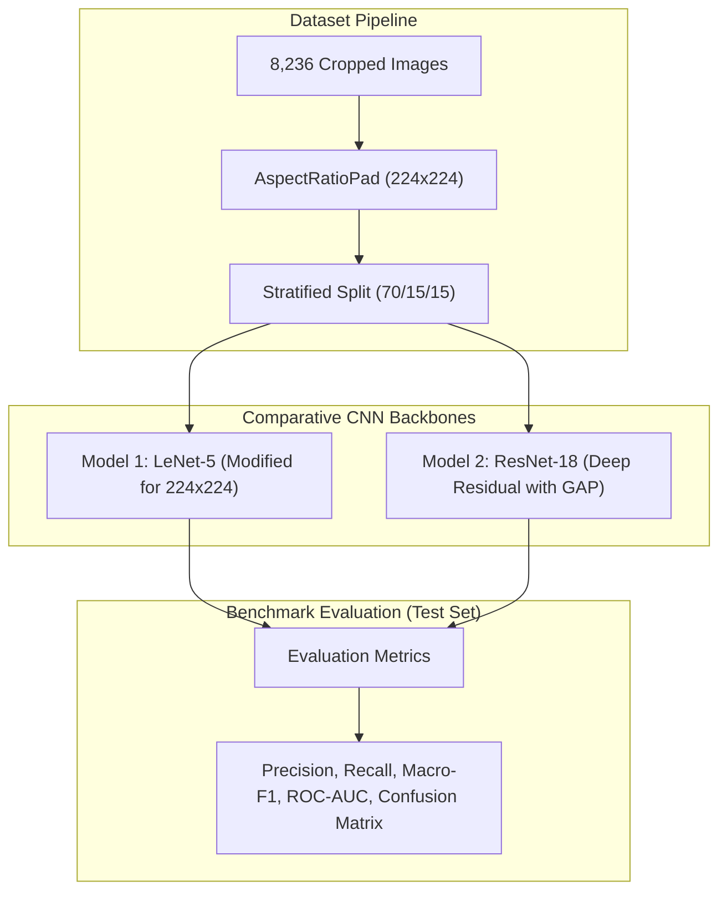

# Academic Research & Engineering Plan: Ad vs. Non-Ad Classification Benchmark

**Project:** National Indic Document Layout Parsing (IndicDLP) | IDEAS-TIH, ISI Kolkata  
**Task:** Binary Ad vs. Non-Ad Classification Benchmark & Evaluation Suite  
**Architectures Selected:** **LeNet-5** (Shallow Classical Baseline) & **ResNet-18** (Deep Residual Baseline)  
**Dataset Base:** 100 Broadsheet Newspaper Scans (*Jugantar*, Jan 1946) across 10 Batches  
**Target:** 8,236 Total Image Crops (1,849 Commercial Advertisements | 6,387 Editorial Non-Ads)  

---

## 1. Executive Summary & Research Motivation

Historical Indic broadsheets present unique visual layout structures:
* **Advertisements:** Characterized by closed outer bounding borders (Faraday border insulation $\Gamma \approx 1.0$), varied typographic font perplexity ($PP = 2^H$), bold headlines, contact addresses, and commercial phrasing.
* **Editorial Non-Ads:** Characterized by uniform column widths, continuous columnar text paragraphs, subheadings, and journalistic captions.

The objective is to train and evaluate two distinct generations of Convolutional Neural Networks (**LeNet-5** and **ResNet-18**) to classify cropped document image snippets as either **Advertisement (Class 1)** or **Non-Ad (Class 0)**.

---

## 2. Solving Variable Bounding Box Sizes: Mathematical Formulation

Standard CNN classification backbones require fixed tensor dimensions for batching and fully connected layers. Historical document bounding boxes exhibit high variance in spatial dimensions:
* Small classifieds: $\approx 120 \times 120$ px ($1:1$ aspect ratio)
* Tall column articles: $\approx 150 \times 900$ px ($1:6$ aspect ratio)
* Bottom broadsheet banner ads: $\approx 1200 \times 250$ px ($4.8:1$ aspect ratio)

### The Solution: Aspect-Ratio Preserving Letterboxing with Reflection/Neutral Padding

Naively resizing an arbitrary bounding box $(W, H)$ to $(224, 224)$ distorts character stroke widths and spatial frequencies. We enforce isotropic scaling:

$$s = \min\left(\frac{224}{W}, \frac{224}{H}\right)$$

$$W' = \lfloor s \cdot W \rfloor, \quad H' = \lfloor s \cdot H \rfloor$$

The scaled image is centered onto a $224 \times 224$ canvas with neutral broadsheet padding (fill value 255):

$$\Delta W = 224 - W', \quad \Delta H = 224 - H'$$

$$\text{pad}_{\text{left}} = \lfloor \Delta W / 2 \rfloor, \quad \text{pad}_{\text{right}} = \Delta W - \text{pad}_{\text{left}}$$

$$\text{pad}_{\text{top}} = \lfloor \Delta H / 2 \rfloor, \quad \text{pad}_{\text{bottom}} = \Delta H - \text{pad}_{\text{top}}$$

This preserves typographic morphology and stroke geometry while ensuring uniform $(3, 224, 224)$ PyTorch tensors for GPU batching.

---

## 3. Dataset Splitting & Class Imbalance Protocol

### 3.1 Stratified Partitioning (70% Train / 15% Val / 15% Test)

To prevent data snooping and ensure unbiased test evaluation, splitting is performed with a fixed random seed (`seed=42`):

| Partition | Percentage | Ad Crops (Class 1) | Non-Ad Crops (Class 0) | Total Crops |
| :--- | :---: | :---: | :---: | :---: |
| **Train Set** | 70% | 1,294 | 4,471 | 5,765 |
| **Validation Set** | 15% | 277 | 958 | 1,235 |
| **Test Set** | 15% | 278 | 958 | 1,236 |
| **Total** | **100%** | **1,849** | **6,387** | **8,236** |

### 3.2 Handling Class Imbalance via Weighted Loss

The dataset has an imbalance ratio of approximately $1 : 3.45$ (18.2% ads vs. 81.8% non-ads). Rather than discarding valuable editorial data through downsampling, we apply **Inverse Frequency Class Weighting** in the loss function:

$$w_c = \frac{N_{\text{total}}}{2 \cdot N_c}$$

$$w_{\text{non\_ad}} = \frac{5765}{2 \cdot 4471} \approx 0.644, \quad w_{\text{ad}} = \frac{5765}{2 \cdot 1294} \approx 2.227$$

Loss Function:
$$\mathcal{L} = - \sum_{i=1}^{B} \left[ w_{\text{ad}} \cdot y_i \log(\hat{y}_i) + w_{\text{non\_ad}} \cdot (1 - y_i) \log(1 - \hat{y}_i) \right]$$

---

## 4. Model Architectures for Academic Benchmarking

### Model 1: Modified LeNet-5 (Shallow Baseline)
* **Design:** 3 Convolutional stages with Max-Pooling + Adaptive Average Pooling + 2 Fully Connected layers with Dropout.
* **Purpose:** Serves as a historical baseline (1998 paradigm). Tests how well low-capacity, shallow feature extractors perform on raw historical document textures.

### Model 2: ResNet-18 (Deep Residual Baseline)
* **Design:** 18-layer deep residual network with residual skip connections, batch normalization, and Global Average Pooling (GAP) before a linear classification head.
* **Purpose:** Modern visual document classification standard. Evaluates deep hierarchical feature representation on complex layout patterns.

---

## 5. Academic Evaluation Metrics

All models will be evaluated strictly on the untouched **Test Set (1,236 images)** using:
1. **Accuracy:** Overall correct predictions.
2. **Precision ($\text{Ad}$):** $\frac{\text{TP}}{\text{TP} + \text{FP}}$ (minimizes false alarms on editorial news text).
3. **Recall ($\text{Ad}$):** $\frac{\text{TP}}{\text{TP} + \text{FN}}$ (measures ability to catch all advertisements).
4. **Macro-F1 Score:** Harmonic mean of precision and recall unweighted by class frequency.
5. **Confusion Matrix:** Explicit count of TP, FP, TN, FN.
6. **Inference Latency:** Average milliseconds per broadsheet crop on CPU and GPU.

---

## 6. Execution Roadmap

1. **Step 1: Dataset Consolidator & Splitter (`dataset_builder.py`)**
   * Scan `Batch_01` through `Batch_10` on Desktop.
   * Organize into `dataset/train/{ad,non_ad}`, `dataset/val/{ad,non_ad}`, and `dataset/test/{ad,non_ad}`.
   * Generate `dataset_manifest.json`.

2. **Step 2: PyTorch Dataset & Transforms (`ad_dataset.py`)**
   * Implement `AspectRatioPad` to $224 \times 224$.
   * Setup `DataLoader` with batch size 32, shuffling, and normalization.

3. **Step 3: Training Engine (`train_ad_classifier.py`)**
   * Train LeNet-5 (10 epochs, weighted CE loss, AdamW).
   * Train ResNet-18 (10 epochs, weighted CE loss, AdamW with transfer learning).
   * Save best model checkpoints: `best_lenet5.pt` and `best_resnet18.pt`.

4. **Step 4: Academic Benchmark Suite (`evaluate_benchmark.py`)**
   * Evaluate both models on the test set.
   * Output comparative markdown tables and confusion matrices.
